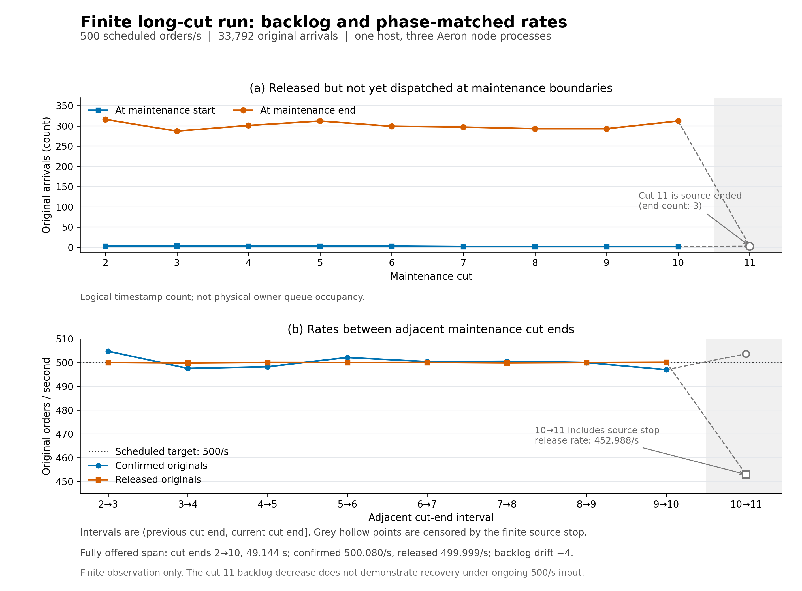

# VectorMatch

**Deterministic execution. Recoverable state. Measured performance.**

A private engineering project exploring a limit-order matching engine, replicated execution, and real-time market data. Every capacity claim must link to its workload, hardware, durability settings, and raw results.

## Delivery principles

- Price-time priority, integer accounting, explicit reservation and settlement.
- A deterministic state machine owns balances, orders, deduplication, and events.
- A timeout is an unknown outcome, not permission to place a second order.
- Local execution, replicated execution, and market delivery are measured separately.
- Performance improvements must pass the same correctness checks as the baseline.

## Implementation status

Executable deterministic matching, a local journaled workbench, a three-process Aeron Cluster backend, replicated bounded outbox, and transactional PostgreSQL event export. The React console shows actual order books, commands, replica checks, cached projection observations, and recorded benchmark evidence. See [the implementation contract](docs/IMPLEMENTATION.md).

Verified locally: leader termination and replacement, snapshot/cold restart with unacknowledged events, outbox backpressure, idempotent retries, PostgreSQL commit-before-ack recovery, and HTTP-to-quorum-to-database execution.

Also verified on **three Runpod Pods using native private UDP**: six-direction network preflight, recorded matching trials, leader-process failure/rejoin, complete JVM cold restart, restored outbox projection and the HTTP/WebSocket workbench. The [reply-rotation investigation](docs/EGRESS_ROTATION.md) preserves the original 521–526 ms tails, real UDP RED/GREEN regression and differing leader placements. These single-inflight correctness smokes have their own scope and remain in the [Runpod evidence](docs/RUNPOD_LAB.md).

The separate [fixed-leader capacity campaign](docs/CAPACITY_RESULTS.md) records open-loop arrival-rate and concurrency curves, planned-to-confirmed p99, backlog, client admission loss, rejection and unknown outcomes. Every point retains raw arrivals, snapshots, process arguments and per-node telemetry. The console keeps different node/load/state profiles in separate selectable curves, including invalid and short-window observations. These are finite client-plus-replicated-matching measurements with the generator sharing member 2; HTTP/projection/fanout capacity and long-run SLAs need separate evidence. Physical anti-affinity and persistence after Pod stop remain unverified. High connection-count fanout, sharding and production authentication remain future work.

The current [CPU cohort](evidence/2026-10-24/runpod-cpu/README.md) uses one existing CPU host after the three GPU Pods were stopped. Its [350k-command capacity curve](evidence/2026-10-24/runpod-cpu/capacity-summary/README.md) preserves both stable13k/s windows, valid18k/26k overload, and an invalid scheduler observation that stopped the remaining matrix. This is three JVMs over loopback UDP, distinct from the historical three-Pod results. The original HTTP/PostgreSQL application is still pending CPU restoration.

A separately registered [node max-park comparison](evidence/2026-10-24/runpod-cpu/node-idle-abab/comparison/README.md) holds source,leader,durability and clients fixed at18k/s:both1ms controls are nonstable,both100us treatments pass the finite-window criteria with350kaccepted/zero not-sent/zero UNKNOWN and all-arrival p9980.19/78.93ms. The subsequent [eight-point fixed100us curve](evidence/2026-10-24/runpod-cpu/park100us-curve/comparison/README.md) retains both repetitions at22k/26k/30k/34k:all are valid overload,window goodput17.63–19.18k/s,accepted-only p99467.62–538.82ms,UNKNOWN0. These finite tests do not uniquely identify a server ceiling. The [100M-order endurance design](docs/CPU_ENDURANCE_DESIGN.md) records the required versioned retention/history protocol rather than combining reset test states.

The independent [client-driver A/B/A/B](evidence/2026-10-24/runpod-cpu/client-driver-experiment/comparison/INTERPRETATION.md) does not support promoting100us over the original1ms client default:the two pairs move in opposite directions for both goodput and accepted-only p99. All four finite overload points and CPU/raw evidence remain visible in separate configuration cohorts. A tracked Archive write-path timing lead motivates isolated storage testing;it is not a purefsync or unique bottleneck claim.

The separate [eight-point synthetic force(true) diagnostic](evidence/2026-10-24/runpod-cpu/force-path-experiment/comparison-r2/README.md) retains all3376operations and3200measurement rows on the existing CPU overlay. Single-writer force medians are1.35–1.40ms;three writer threads in oneJVM show2.51–2.77ms medians and4.65–4.99ms rowp99. This supports investigating durable batching;it is not transaction latency,a stable-throughput improvement or a unique disk ceiling. The prior parser-failed attempt is retained separately.

The opt-in [V3 bounded batch/maintenance candidate](evidence/2026-10-24/runpod-cpu/retention-batch-maintenance-v3/README.md) retains its initial forced rerun (243 passed, 11 PostgreSQL-dependent skips) and six complete native trees. Its source is now integrated into main; the later [forced integration validation](evidence/2026-10-24/runpod-cpu/retention-integration-v3/validation-r1/README.md) passes all 291 tests with zero skips, including PostgreSQL against a dedicated fresh test database. Failed and successful runs are retained. V2 remains the default service. Raw reconciliation confirms 10,003 business commands/20,003 events, exact prefix exports and same-wire ACK replay. The separate [continuous-arrival CPU pilot](evidence/2026-10-24/runpod-cpu/retention-capacity-v3/cloud-pilot-r1/README.md) keeps arrivals running through maintenance: both batch-cap 1/4 arms eventually confirm all 6,400 orders, while their finite 500/s exposures end with outstanding replies, 239.77/s window goodput and all-arrival p99 of 7.536/7.400 seconds. Each arm makes 1,785 serial maintenance RPCs across three cycles, taking about 14 seconds. This is a distinct bounded V3 workload, with complete raw/native evidence; it establishes neither sustained 500/s capacity, a unique instability threshold nor a 100M result.

The subsequent [same-artifact chunk-size ABAB](evidence/2026-10-24/runpod-cpu/retention-chunk-v3/cloud-abab-r3/README.md) fixes business batch cap 4 and compares 3072/6144-byte archive chunks twice. Controls have all-arrival p99 of 7.369/8.671 seconds; treatments have 4.888/4.858 seconds, reductions of 33.66%/43.97%. Window goodput rises from 239.77 to 479.77 orders/s, while maintenance RPCs fall from 1,785 to 1,298. Each of the four cohorts confirms all 6,400 orders with zero UNKNOWN, rejection or notSent. The treatments have seconds of latency/drain, but [exact arrival/reply timelines](evidence/2026-10-24/runpod-cpu/retention-chunk-v3/periodic-backlog-interpretation-r1/README.md) show recovery between their first two full cuts. The historical finite-window overload label does not prove unbounded queue growth at 500/s; sustainable capacity and a unique instability threshold remain unproved.

The [bounded maintenance read-window candidate](docs/RETENTION_READ_WINDOW_V3.md) is integrated into main. Its 133 scoped checks pass with zero skips; preceding failed attempts are retained. The subsequent [same-artifact CPU read-window ABAB](evidence/2026-10-24/runpod-cpu/retention-window-v3/cloud-abab-r1/README.md) fixes business cap 4/chunk 6144/fetch 16 and compares windows 1/8 twice. All-arrival p99 falls from 5.033/5.056 seconds to 0.774/0.810 seconds, reductions of 84.62%/83.98%; complete maintenance wall time falls about 83%. Window goodput remains 479.77 orders/s in all four arms. Each fresh lineage confirms all 6,400 unique orders with zero UNKNOWN, rejection or notSent, exact archive/event/reference/snapshot checks, and independently reconstructed offered-awaiting-callback peaks of 1/8. Full native bytes and raw records are retained. These short, fixed-order observations establish a repeatable latency improvement, not sustained 500/s capacity, independent-host performance or a 100M result.

The opt-in [V3 park-policy comparison](cluster/RETENTION_IDLE_V3.md) is integrated with [168 scoped checks](evidence/2026-10-24/runpod-cpu/retention-idle-v3/local-unit-validation-r1/README.md) and [qualified local native evidence](evidence/2026-10-24/runpod-cpu/retention-idle-v3/local-native-validation-r2/README.md). Both local arms confirm 6,400 distinct orders and matching state in their separate lineages; both local scheduler timings are invalid, so they provide no performance comparison. The original failed strict wrapper and two terminal follower EOS warnings remain archived. A narrow separately reviewed warning classifier retains every log line and does not prove SIGTERM causality or absence of an election. [Linux metadata](evidence/2026-10-24/runpod-cpu/retention-idle-v3/release-metadata-r1/README.md) binds the actual new artifact and unchanged codec plan.

The subsequent [same-artifact CPU idle ABAB](evidence/2026-10-24/runpod-cpu/retention-idle-v3/cloud-abab-r1/comparison/README.md) fixes read window8 and compares maximum requested parks1ms/100us twice. Planned-arrival-to-confirmation p99 falls899.509→562.918ms and916.237→558.369ms (37.42%/39.06%); complete three-cycle maintenance wall time falls35.02%/35.19%. All four fresh lineages confirm6,400 distinct orders with zero UNKNOWN, rejection, notSent, scheduler lateness over20ms or node warnings. Window goodput remains479.765625/s. All three nodes use more sampled arrival-window CPU in both pairs; parent CPU changes inconsistently. For each arm's same64 slowest arrivals,98.85–98.96% of summed latency occurs before dispatch. Queue waiting, the explicit maintenance dispatch pause and dispatch scheduling remain combined in that component. These finite same-host observations establish a repeatable latency/CPU tradeoff, without proving sustained500/s capacity, a unique server/network ceiling, hard realtime or any100M target.

The explicit [long-cut workload](cluster/RETENTION_LONG_CUTS_V3.md) is integrated with [53 scoped checks](evidence/2026-10-24/runpod-cpu/retention-long-cuts-v3/local-unit-validation-r1/README.md) and [qualified local native evidence](evidence/2026-10-24/runpod-cpu/retention-long-cuts-v3/local-native-validation-r1/README.md). One lineage confirms all 33,792 fresh load orders across twelve maintenance cycles, including ten equivalent setup-free full cuts. The local scheduler has 26 arrivals over 20ms late, so this is functional/canonical evidence only. All 191 original native entries remain in the full compressed archive; the frozen Python auditor reproduces its complete result byte-for-byte using archived inputs. The first failed derived audit and its source-backed correction remain retained. [Actual Linux metadata](evidence/2026-10-24/runpod-cpu/retention-long-cuts-v3/release-metadata-r1/README.md) binds the new artifact and admitted long plan.

The subsequent [actual CPU long-window run](evidence/2026-10-24/runpod-cpu/retention-long-cuts-v3/cloud-long-r1/README.md) confirms all 33,792 fresh load orders at a scheduled 500/s over 67.584 seconds. It records zero UNKNOWN, rejection, notSent, scheduler lateness over 20ms or node warnings; 33,789 replies arrive inside the source window, giving 499.956/s window goodput. All-arrival planned-to-reply p99 is 554.294ms. The [independent cut analysis](evidence/2026-10-24/runpod-cpu/retention-long-cuts-v3/cloud-long-cut-analysis-r1/README.md) isolates eight fully offered intervals between cut ends 2–10: over 49.144 seconds, 24,576 orders confirm versus 24,572 released, with released-but-unconfirmed backlog changing by −4. Cut 11 ends after arrivals stop and is excluded from that recovery comparison. These are finite observations on three JVMs sharing one CPU host and loopback UDP; they establish neither maximum throughput, indefinite stability, hard realtime nor a 100M target. Full raw/native tapes, source, failed preparation attempts and portable analysis reproduction remain archived.



The [standalone figure and mapped source values](evidence/2026-10-24/runpod-cpu/retention-long-cuts-v3/cloud-long-cut-figures-r1/README.md) retain PNG, SVG and PDF outputs. The upper panel counts released arrivals awaiting dispatch at maintenance boundaries; it does not measure physical queue occupancy. Grey hollow marks identify source-exhausted observations.

[Original application CPU recovery](docs/CPU_RESTORATION_PLAN.md) has separately restarted the original native clones and observed the leader after tail replay at command4609/event6214/market6194/export6214. A new checkpoint was then taken, all owned processes cleanly stopped, and three actual service recordings independently decoded: complete engine and combined core/outbox bytes agree, with the PG baseline unchanged. The [full historical offline check](evidence/2026-10-24/runpod-cpu/restoration-preparation/original-full-ledger-offline-r1/README.md) now matches all 4,609 copied commands/results and 6,214 derived events to the archived PG ledger, with byte-identical final engine state and independent Python verification. Cold restart from the new checkpoint and HTTP/WS recovery remain pending. An explicit [passive gateway startup option](docs/PASSIVE_GATEWAY_RESTORATION.md) disables bootstrap and flow before construction; its tested artifact is preserved independently.

## Toolchain

Java 21, Gradle, Aeron, Netty, React and TypeScript. The bootstrap pins Temurin 21.0.13+9, Node 24.22.1 and Gradle 8.14.3 and verifies vendor SHA-256 files. Portable development tools live under `.tools/` and are never committed.

```bash
python3 scripts/bootstrap.py
source scripts/env.sh
./gradlew check
cd web && npm ci && npm run build && cd ..
bash scripts/run-workbench.sh
```

Open <http://127.0.0.1:8000>. The workbench binds only to loopback. It starts a synthetic market flow using the real engine, and labels its execution mode `LOCAL_JOURNALED`. Its WebSocket feed sends complete snapshots at 5 Hz; it does not claim reliable individual-event delivery.

The console supports order placement and cancellation, actual browser command RTT samples, server service time, flow controls, and replay verification. Its Evidence section reads the repository's recorded results; it does not turn live demo activity into a capacity claim.

## Replicated workbench and database

```sh
python3 scripts/bootstrap-postgres.py
export VM_CLUSTER_ID='local-cluster-generation-1'
bash scripts/run-replicated.sh
```

Open <http://127.0.0.1:8001>. This runs the gateway and projector in the foreground and preserves the cluster and PostgreSQL processes/data after exit. The default cluster profile requests Archive/catalog/consensus sync level 2. Use a stable, unique lineage ID for each cluster/database pair; never reuse an ID after resetting either side. A second stack launcher is refused before creating Aeron driver directories. Read [deployment and durability](deploy/README.md), [projection recovery](projector/README.md), and [checkpoint capacity](cluster/CAPACITY.md) before changing an existing runtime.

The gateway's order/account reads are a checked in-memory mirror of the replicated core. PostgreSQL currently stores an event ledger, counters, cursor and sanitized market view; it is not a complete order-query service. Its observer performs database I/O on a separate thread, and reports cached/stale/unavailable status explicitly.

The gateway polls core sequence positions once per second and refreshes its mirror when another client changes the core. A transport/session failure enters `BACKEND_RECOVERY_REQUIRED`: restart the gateway to reconnect and reload a snapshot, then reconcile an unknown request using its original producer ID, sequence and payload. Core leader failover does not imply uninterrupted gateway availability in this first release.

```sh
python3 scripts/verify-replicated-workbench.py
export VM_TEST_PG_URL='jdbc:postgresql://127.0.0.1:55432/postgres?user=vectormatch'
./gradlew check :cluster:failoverSmoke
```

The functional verification pauses synthetic flow and leaves it paused. Test JDBC settings must be provided for the real PostgreSQL suite; otherwise those tests are reported as skipped.

## First performance baseline

```bash
./gradlew :bench:installDist
bench/build/install/bench/bin/bench 20000 3 reports/local/core-20k
```

This measures a fixed-rate **in-process memory-only** path, including scheduling delay in its main latency histogram. It excludes network, persistence, and replication. Raw baseline artifacts are in `evidence/`; see [measurement boundaries](docs/BENCHMARKS.md).

The repository also includes a bounded [HTTP arrival-rate generator](bench/HTTP_LOAD.md), [replicated concurrency experiment](cluster/BENCHMARKS.md), and [USD 20 cloud campaign](docs/CLOUD_TESTING.md). Recorded smoke results are evidence for further investigation, not production latency or throughput guarantees.

