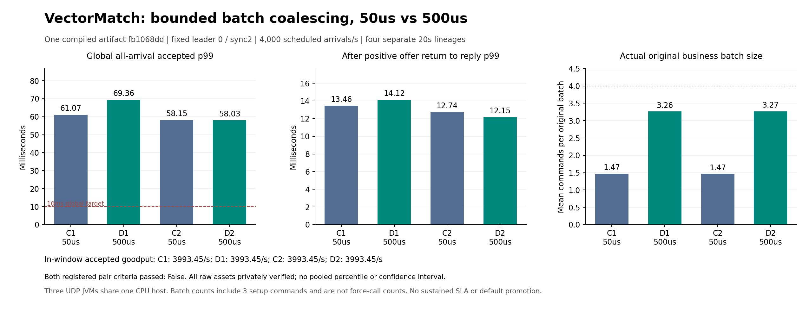

# Bounded batch coalescing:50us versus500us

[Prospective protocol](V4_BATCH_COALESCING_PROTOCOL.md) · [Exact compiled Linux qualification](../evidence/2026-10-26/runpod-cpu/v4-batch-coalescing-r1/linux-admission-r1/README.md).

All four safety/correctness checks passed. All finite gates passed: **True**. Both registered pair criteria passed: **False**. Both candidates meet10ms global p99: **False**. No default promotion or sustained SLA follows from these two finite repeats.

| Arm | Batch eligibility delay | Accepted | In-window goodput/s | Global p99 ms | Post-offer p99 ms | Distinct original business batches |
|---|---:|---:|---:|---:|---:|---:|
| C1 | 50us | 80000/80000 | 3993.45 | 61.066958 | 13.462297 | 54,350 |
| C2 | 50us | 80000/80000 | 3993.45 | 58.148345 | 12.744526 | 54,571 |
| D1 | 500us | 80000/80000 | 3993.45 | 69.362351 | 14.122611 | 24,516 |
| D2 | 500us | 80000/80000 | 3993.45 | 58.033456 | 12.154013 | 24,454 |

Leader0,sync2,CONTINUE,CLOSED read banks,agent100us,owner1ms,127 active producers/128 slots,Q64,batch4,cut1536,read32/page32/chunk6144 and ports22000 stay fixed. The same CI22-compiled artifact `fb1068dd` is used in all arms. No observer JVM runs here. Each arm is a separate fresh lineage;percentiles are not pooled. Earlier artifactdcfeeb81 counter observations and latency-factor comparisons remain separate.

The criterion uses exact integer nanoseconds and acceptance counts:each candidate needs at least10% lower global all-arrival accepted p99,no worse post-positive-offer p99,and no lower in-window accepted count;both arms must pass the finite gate. Global p99 is undefined when any planned arrival lacks a distinct accepted result. A conditional percentile never replaces it.

`{"bothFiniteGates": true, "candidate": "d1", "control": "c1", "globalP99AtLeastTenPercentBetter": false, "inWindowAcceptedNoRegression": true, "postOfferP99NoRegression": false, "registeredCriterionPassed": false}`

`{"bothFiniteGates": true, "candidate": "d2", "control": "c2", "globalP99AtLeastTenPercentBetter": false, "inWindowAcceptedNoRegression": true, "postOfferP99NoRegression": true, "registeredCriterionPassed": false}`

All four raw assets were completely authenticated-downloaded and every member verified. Each retains every planned arrival,original physical request/reply,trade/event prefix,absolute permit,forced/readback receipt,full canonical replay,all three actual snapshots and all three actual cold restores. Independent parameter proof binds the parent argv,registration,configuration,summary and both actual owner snapshots;all six original/cold node processes retain their idle/artifact identity checks.

The preceding native500/s candidate qualification accepted all10000 orders,goodput499.85/s,globalp9945.992853ms. It proves finite functional qualification and is not included as a capacity comparison point.

Original whole-source batch-size counts include three bootstrap commands:
- C1: `{"1": 44943, "2": 597, "3": 1374, "4": 7436}`
- C2: `{"1": 45117, "2": 753, "3": 1424, "4": 7277}`
- D1: `{"1": 61, "2": 2303, "3": 13272, "4": 8880}`
- D2: `{"1": 83, "2": 1652, "3": 14260, "4": 8459}`

Batch-request counts are not archive write/force-call counts. They show the measured coalescing behavior but cannot alone prove disk timing causality. Post-offer latency includes replication,execution,reply encoding and client polling. One-second backlog samples can miss short queues. Two20-second repeats establish neither statistical significance nor long-term latency,hard realtime,HFT endorsement,independent-host failure isolation or continuous100M.

[Complete comparison derivation,all private raw references,execution logs and preserved index/report snapshots](../evidence/2026-10-26/runpod-cpu/v4-batch-coalescing-r1/comparison-r1/README.md).

[SVG](../evidence/2026-10-26/runpod-cpu/v4-batch-coalescing-r1/comparison-figure-and-closure-r1/v4-batch-coalescing-figure-r1/batch-coalescing.svg). The immutable original publication snapshot remains in comparison-r1;this later figure only presents its unchanged four measured arms.
