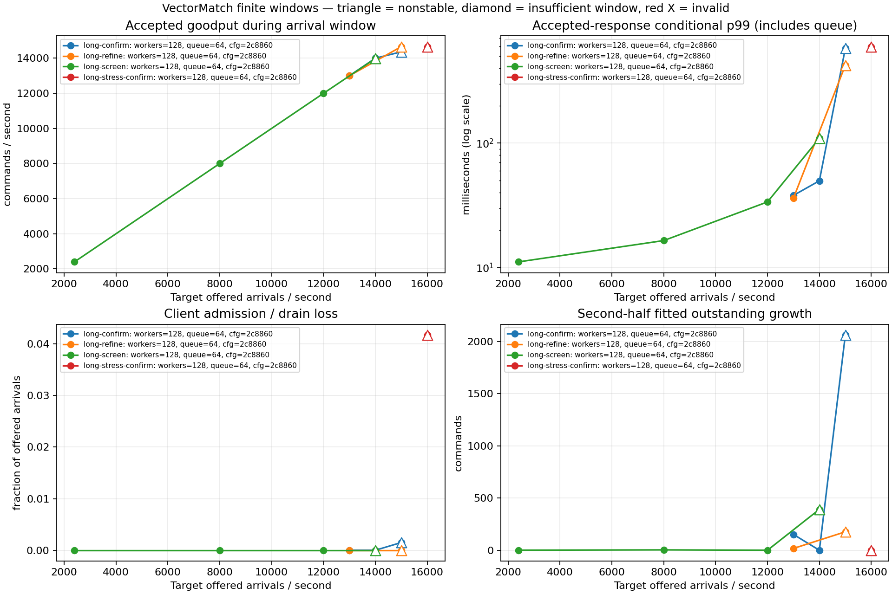
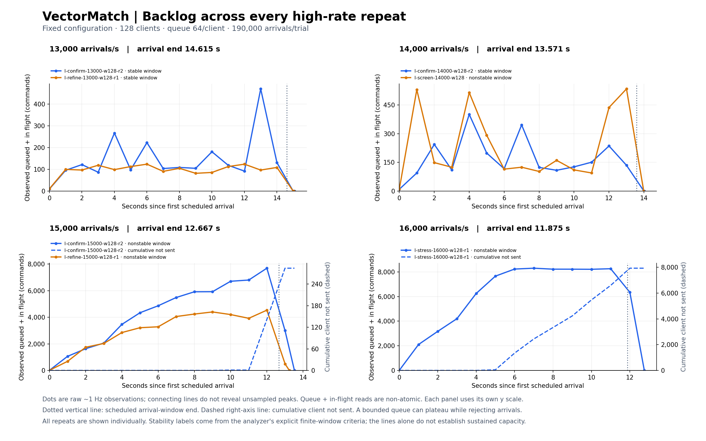
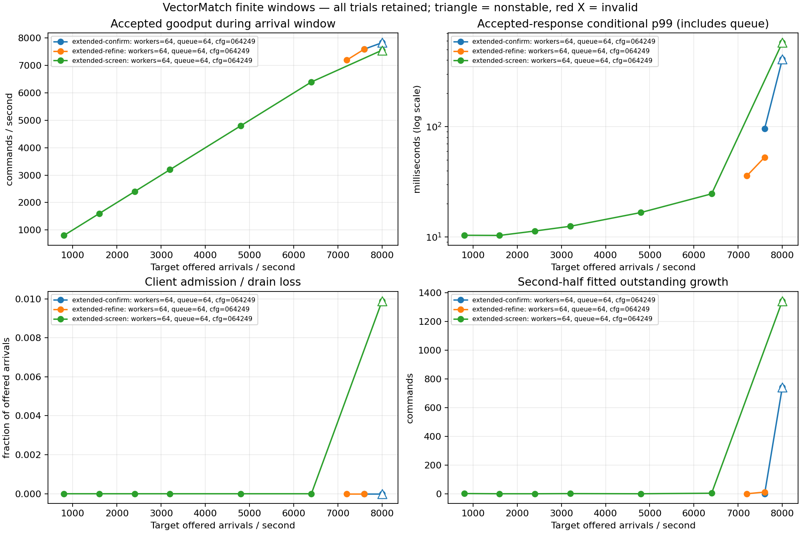

# 三节点容量压测结果

本报告纳入已完成并校验的 **38 轮**：baseline 11 轮、extended 11 轮、固定节点的 64/128 客户端对照与短窗观察 6 轮、独立 190k 长窗配置 10 轮。容量负载已结束，全部轮次与未通过的结果均保留。

当前较大的固定配置使用 **128 客户端、节点 heap 2 GiB、190k 样本上限**。结果是：**13k/s 两次均为合格稳定窗口，p99 为 36.128553–38.000351 ms；15k/s 两次均未满足稳定标准；14k/s 一稳一非稳**。13k/s 两轮窗口内确认吞吐为 **12,992.9526/s、12,992.8158/s**，所有计划命令均被接受。16k/s 单次 11.875 秒窗口还出现了明确队列损失。由此得到该固定调用路径的重复通过点 13k、重复未通过点 15k，以及 14k 的混合过渡带；没有一个可承诺的精确后端上限。负载端仍与 member 2 共用 Pod。

## 190k 长窗结果：13k 重复通过，15k 重复未通过，14k 混合

这一组的节点与负载端源均为 `b6f6c5cd165110e330d409e2ff51ee4574a3720b`，固定准备 SHA 为 `2247db9c15b0043a0b28172c5bfa2d9e4f20b5748f6a16424d881e296102655f`，组内配置和初态一致。每个 worker 的队列仍为 64，测量期间不改变配置。

| 新长窗轮次 | 计划命令数 | 窗口 | 窗口内确认 /s | 全量接受 p99 | 条件 p99 | 客户端未发送 | 峰值排队 | 排空时间 | 判定 |
|---|---:|---:|---:|---:|---:|---:|---:|---:|---|
| [2,400/s](../evidence/2026-10-23/runpod-capacity-long/runs/l-screen-2400-w128/) | 72,000 | 30 s | 2,399.4333 | 11.096743 ms | 11.096743 ms | 0 | 1 | 12.500 ms | 稳定窗口 |
| [8,000/s](../evidence/2026-10-23/runpod-capacity-long/runs/l-screen-8000-w128/) | 190,000 | 23.75 s | 7,997.6421 | 16.469738 ms | 16.469738 ms | 0 | 4 | 7.845 ms | 稳定窗口 |
| [12,000/s](../evidence/2026-10-23/runpod-capacity-long/runs/l-screen-12000-w128/) | 190,000 | 15.833333333 s | 11,991.4737 | 33.686229 ms | 33.686229 ms | 0 | 200 | 10.520 ms | 稳定窗口 |
| [13,000/s，首次](../evidence/2026-10-23/runpod-capacity-long/runs/l-refine-13000-w128-r1/) | 190,000 | 14.615384615 s | 12,992.9526 | 36.128553 ms | 36.128553 ms | 0 | 26 | 9.002 ms | 稳定窗口 |
| [13,000/s，复测](../evidence/2026-10-23/runpod-capacity-long/runs/l-confirm-13000-w128-r2/) | 190,000 | 14.615384615 s | 12,992.8158 | 38.000351 ms | 38.000351 ms | 0 | 342 | 11.279 ms | 稳定窗口 |
| [14,000/s，首次](../evidence/2026-10-23/runpod-capacity-long/runs/l-screen-14000-w128/) | 190,000 | 13.571428571 s | 13,975.0211 | 109.463649 ms | 109.463649 ms | 0 | 406 | 151.930 ms | 非稳定窗口 |
| [14,000/s，复测](../evidence/2026-10-23/runpod-capacity-long/runs/l-confirm-14000-w128-r2/) | 190,000 | 13.571428571 s | 13,991.8947 | 49.785161 ms | 49.785161 ms | 0 | 273 | 17.190 ms | 稳定窗口 |
| [15,000/s，首次](../evidence/2026-10-23/runpod-capacity-long/runs/l-refine-15000-w128-r1/) | 190,000 | 12.666666666 s | 14,650.4211 | 422.245419 ms | 422.245419 ms | 0 | 4,404 | 516.951 ms | 非稳定窗口 |
| [15,000/s，复测](../evidence/2026-10-23/runpod-capacity-long/runs/l-confirm-15000-w128-r2/) | 190,000 | 12.666666666 s | 14,355.3947 | 不可用 | 577.398433 ms | 284 | 7,558 | 596.226 ms | 非稳定窗口 |
| [16,000/s，首次](../evidence/2026-10-23/runpod-capacity-long/runs/l-stress-16000-w128-r1/) | 190,000 | 11.875 s | 14,635.1158 | 不可用 | 596.325768 ms | 7,932 | 8,173 | 553.876 ms | 非稳定窗口 |

14k 首次全部成交，只因排空 **151.930 ms > 135.714 ms** 的本轮阈值而失败；复测排空降至 17.190 ms 并通过。应将两轮并列为混合结果，不能选择其中一轮代替完整结论。16k 首次有 7,932 条明确的客户端队列满未发送，窗口内确认比例和排空均未通过；队列接近满载时，拟合增长可能变平，因此“积压增长检查通过”本身不代表稳定。

15k 首次 190,000 条命令均接受，窗口内确认 14,650.4211/s，但排空 **516.951 ms > 126.667 ms**。复测 284 条请求在客户端队列满时未发送，排空 596.226 ms、后半程拟合积压增长 2,062.712 条也超过本轮 1,900 条的容忍量。两轮均为非稳定，且没有业务拒绝或 unknown；首次全量接受和两次最终状态正确仍不能替代排队/排空要求。存在未发送请求的复测只能报告已接受回复的条件 p99，不能为全量请求填写一个有限 p99。

[全精度 CSV](../evidence/2026-10-23/runpod-capacity-long/analysis/capacity.csv) · [全部校验和判定](../evidence/2026-10-23/runpod-capacity-long/analysis/summary.json) · [跨 phase 重复汇总](../evidence/2026-10-23/runpod-capacity-long/analysis/repeats.json) · [SVG 曲线](../evidence/2026-10-23/runpod-capacity-long/analysis/capacity.svg)





跨 phase 汇总按完整配置 fingerprint、worker/队列数、目标到达率、计划数量和窗口时长严格匹配，保留每一轮后再判断重复结果：13k 为 `REPEATEDLY_STABLE_WINDOW`，14k 为 `MIXED`，15k 为 `REPEATEDLY_NONSTABLE_WINDOW`。p99 范围表示逐轮 p99 的范围，没有把它误称为合并样本的 p99。该汇总脚本另有 [9 项测试通过记录](../evidence/2026-10-23/runpod-capacity-long/tool-validation/repeat-summary-tests.json)。

14k 复测在云端已完成后，本地导出遇到磁盘空间不足。清理可重建副本后，只重新导出同一轮数据，未重发业务负载；独立云/本地归档哈希一致，处理记录见 [export-recovery.json](../evidence/2026-10-23/runpod-capacity-long/tool-validation/export-recovery.json)。这次导出故障没有被当作新一轮试验，也没有删去其原始记录。

## 先前 64-client 边界与客户端窗口诊断

先前固定 64 个客户端时，**7,600/s 两次满足稳定窗口标准，8,000/s 两次未满足**。这些试验使用旧的 1 GiB 节点、90k 样本配置，各轮初态与源一致。增加客户端的控制试验随后证实，这个边界含有客户端窗口限制，不能解释为后端本身的上限。

同节点、同新负载端的并发对照表明，增加到 128 客户端后 **8,000/s 的排队明显改善**；**9,000/s 在一次 10 秒窗口内全部接受，窗口内确认 8,992.4/s、p99 22.754730 ms**。这是旧 1 GiB 节点配置下最高的已测合格稳定窗口。10k、12k、16k 的更短试验只用于观察高负载行为，不列为满足最低时长标准的持续容量证据。

7,600/s 两次的窗口内确认吞吐为 **7,595.9467/s、7,594.8489/s**，全部计划命令成交，p99 为 **52.768010–95.828644 ms**。两次结果都保留，不能只选择延迟较低的一次宣传。8,000/s 的两次表现如下。

| 64 客户端轮次 | 到达窗口 | 窗口内确认吞吐 /s | 全部计划命令的接受 p99 | 已接受回复的条件 p99 | 客户端未发送 | 峰值排队 | 排空时间 | 判定 |
|---|---:|---:|---:|---:|---:|---:|---:|---|
| [7,600/s，首次](../evidence/2026-10-23/runpod-capacity-extended/runs/x-refine-7600-w64/) | 11.842105263 s | 7,595.9467 | 52.768010 ms | 52.768010 ms | 0 | 153 | 7.856 ms | 稳定窗口 |
| [7,600/s，复测](../evidence/2026-10-23/runpod-capacity-extended/runs/x-confirm-7600-w64-r2/) | 11.842105263 s | 7,594.8489 | 95.828644 ms | 95.828644 ms | 0 | 357 | 14.081 ms | 稳定窗口 |
| [8,000/s，首次](../evidence/2026-10-23/runpod-capacity-extended/runs/x-screen-8000-w64/) | 11.25 s | 7,555.6444 | 不可用 | 576.183419 ms | 890 | 4,004 | 556.494 ms | 非稳定窗口 |
| [8,000/s，复测](../evidence/2026-10-23/runpod-capacity-extended/runs/x-confirm-8000-w64-r2/) | 11.25 s | 7,830.1333 | 407.244710 ms | 407.244710 ms | 0 | 1,914 | 455.311 ms | 非稳定窗口 |

首次 8,000/s 同时未通过全量接受、窗口内确认比例、排空时间和后半程积压增长检查。复测虽然全部接受，排空时间仍超过该窗口的 **112.5 ms** 限制，因此保持非稳定判定。该复测的积压拟合增长约 742.853 条，低于 900 条容忍量，不能声称它也未通过积压增长检查。

## 容量和延迟如何计算

负载发生器按绝对 `System.nanoTime()` 时刻计划到达，不等待上一条回复才计划下一条。到达请求进入固定大小的 worker FIFO，每个 worker 最多有一个同步请求在途。于是计划到达率独立于回复速度，实际服务并发仍受到客户端窗口约束。

本报告的吞吐是**计划到达窗口内收到确认的成功业务命令数 ÷ 到达窗口时长**。窗口结束后的补处理计入排空时间，不补进这个吞吐。p99 从计划到达时刻计到确认，包含发生器调度误差、客户端排队和集群调用；另保留 execute API RTT、队列延迟与调度迟到，方便解释长尾。

只要有任意计划请求未被接受，全量计划命令的接受 p99 就不可用。表中的 576.183419 ms 只描述已接受回复，不能代表那 890 条未发送请求。客户端队列满属于负载端准入损失，业务拒绝和 unknown 分别统计；超时会保留原身份重试，不能解释为交易失败。

测前声明的稳定窗口标准是：校验通过、leader/term 未变、至少观察 10 秒、全部计划请求被接受、无初次或最终 unknown、窗口内确认达到目标率的 95%、排空时间不超过 `max(100 ms, 窗口的 1%)`，后半程 outstanding 拟合增长不超过 `max(2 条, 总到达数的 1%)`。这些标准容许少量正漂移，并非数学上的长期稳定性证明；p99 没有被事后设成筛选漂亮容量数字的门槛。

## 为什么还要增加客户端做对照

baseline 已经显示客户端窗口会改变结论。同样的 2,400/s，在 16 客户端下仅确认 2,099.750/s、2,572 条未发送、条件 p99 达 517.107 ms；改为 32 或 64 客户端后，全部接受，p99 分别为 11.246123 ms 和 10.322596 ms。32/64 客户端在 3,000/s 也均满足稳定窗口标准。因此 16 客户端的失稳点不能用来解释服务端本身的极限。

128 客户端后续试验保持三节点 **8b4** 部署和配置不变，使用同一个新的负载端版本分别跑 64/128 对照。新负载端支持更多 worker 共用原先的 64 个账户，producer 身份仍独立；两种并发都使用同一新实现。连接建立与 session 清理发生在测量窗口外。这样能检查增加在途窗口后，8,000/s 的排队和排空是否改善。

这个独立对照组已经完成 6 轮，每轮均计划 90,000 条命令：

| 新负载端对照 | 窗口 | 窗口内确认 /s | 全量接受 p99 | 已接受条件 p99 | 客户端未发送 | 排空时间 | 判定 |
|---|---:|---:|---:|---:|---:|---:|---|
| [8,000/s，64 客户端](../evidence/2026-10-23/runpod-capacity-128/runs/z-control-8000-w64/) | 11.25 s | 7,839.0222 | 373.619725 ms | 373.619725 ms | 0 | 406.441 ms | 非稳定窗口 |
| [8,000/s，128 客户端](../evidence/2026-10-23/runpod-capacity-128/runs/z-control-8000-w128/) | 11.25 s | 7,993.9556 | 24.148826 ms | 24.148826 ms | 0 | 12.094 ms | 稳定窗口 |
| [9,000/s，128 客户端](../evidence/2026-10-23/runpod-capacity-128/runs/z-control-9000-w128/) | 10 s | 8,992.4000 | 22.754730 ms | 22.754730 ms | 0 | 16.178 ms | 稳定窗口 |
| [10,000/s，128 客户端](../evidence/2026-10-23/runpod-capacity-128/runs/z-screen-10000-w128/) | 9 s | 9,990.1111 | 30.144464 ms | 30.144464 ms | 0 | 10.593 ms | 时长不足 10 秒 |
| [12,000/s，128 客户端](../evidence/2026-10-23/runpod-capacity-128/runs/z-screen-12000-w128/) | 7.5 s | 11,984.6667 | 40.047198 ms | 40.047198 ms | 0 | 9.344 ms | 时长不足 10 秒 |
| [16,000/s，128 客户端](../evidence/2026-10-23/runpod-capacity-128/runs/z-screen-16000-w128/) | 5.625 s | 10,515.3778 | 不可用 | 1,108.435171 ms | 22,575 | 1,078.317 ms | 时长不足；有过载迹象 |

新 64-client 控制点的初次 execute RTT p99 为 11.230764 ms，队列等待 p99 为 365.534518 ms。按每条请求的在途区间重算，它平均占用 63.444809 / 64 个同步槽；128-client 在同为 8k 的窗口平均占用 64.173708 / 128 个槽，mean API RTT 仍接近 8 ms。这支持客户端窗口与排队解释；槽数增加后整体结果改善，不能把原来的约 8k 边界叫作后端上限。完整算法和逐 worker 核对见[对照组报告](../evidence/2026-10-23/runpod-capacity-128/README.md)。

16k 短窗具有直接的过载观察：22,575 条未发送、峰值排队 8,156、条件 p99 约 1.108 秒，同时 leader 网络命名空间在采样覆盖的内部测量区间出现 **UDP InErrors +1,302、RcvbufErrors +1,302**。两项计数重叠，不能相加成 2,604 次独立丢包，也不能等同于业务订单损失。它们支持接收/修复路径压力，但未隔离到具体 socket 或唯一根因。该 5.625 秒点的正式分类仍是 `INSUFFICIENT_WINDOW_OBSERVATIONS`；报告保留其丢弃和排队事实，不把最低时长标准改小来宣布持续上界。

## 固定配置与可比性

三台均为已有的 Runpod EU-RO-1 Pod，使用私网 UDP；可见 CPU 配额上界依次为 5.1、10.2、23.8 个 CPU 等价量。负载端与 member 2 共址。这些是共享容器的可见上界，物理宿主机反亲和未经供应商证明。原应用 gateway、projector、PostgreSQL 在测试窗口暂停，试验使用独立的新状态目录，未对原业务状态做重置。

共同设置包括 leader 0、Aeron 1.53.3、Java 21.0.13、sync level 2、MTU 1248、负载端 heap 2 GiB、SHARED driver/archive、默认 BackoffIdleStrategy、128 KiB UDP 收发缓冲、128 个 session 上限、每 worker 64 队列、2 秒请求超时、30 秒最大排空等待与 20 ms 发生器调度迟到失效阈值。前三组节点 heap 1 GiB，新长窗组节点 heap 2 GiB，分别保留配置身份。Aeron appointed-leader 属于测试设置；正常 HA 部署不依赖这个设置。

| 证据组 | Node 部署版本 | Loadgen 版本 | 固定准备与 outbox | 已完成轮次 |
|---|---|---|---|---:|
| [baseline](../evidence/2026-10-23/runpod-capacity/README.md) | `9fd6f92f5d462bc383006896c7291359094e8645` | 同 node bundle | 64 买方各 300M quote、60k maker、outbox 65,536 | 11 |
| [extended](../evidence/2026-10-23/runpod-capacity-extended/README.md) | `8b4bea3f37d623cd08f7c26ea4b5f6506fc3c5bd` | 同 node bundle | 64 买方各 900M quote、180k maker、outbox 262,144 | 11 |
| [128 对照组](../evidence/2026-10-23/runpod-capacity-128/README.md) | 同 extended node | `ed273d53dffe1e4aa5c95086f59fccc4a25cea4d` | 保持 extended 的账户、maker、outbox；连接并行度 8、清理等待 12 秒 | 6 |
| [190k 长窗组](../evidence/2026-10-23/runpod-capacity-long/README.md) | `b6f6c5cd165110e330d409e2ff51ee4574a3720b` | 同 node bundle | 64 买方各 1.9B quote、380k maker、outbox 524,288、节点 2 GiB | 10 |

每组使用相同组内准备状态：一个价格 10,000 ticks 的 GTC 卖单、100 条预热单，测量阶段每条命令为独立的一 lot IOC 买单，成功时恰好成交一笔。baseline 最多 30k arrivals，extended 最多 90k；这些界限避免把 outbox 或 retained-order 容量保护误读为吞吐饱和。

Node 与 loadgen 的 revision、部署包 SHA、prepared snapshot SHA、固定配置均纳入比较身份。后续 loadgen 可与 node 使用不同版本，两者分别记录。baseline、extended 和新 loadgen 对照保留独立曲线。screen/refine/confirm 的 phase 只记录试验来源；extended 边界的两次同 rate、同 90k 数量、同窗口、同源和同 fingerprint，允许在文字中描述为复测，原 JSON 分组仍保留 phase。

为使更高 rate 也有至少 10 秒观察时间，另行登记并测量 [190k 长窗 profile](../evidence/2026-10-23/runpod-capacity-long/campaign.json)：节点 heap 2 GiB、outbox 524,288、200k retained-order 上限、512 MiB full-checkpoint 上限，固定准备为每买方 1.9B quote 与 380k maker。它使用显式的测试状态 profile，默认应用的 100k/256 MiB 边界保持。新 profile 的源、初态、heap 与状态容量均独立标识，不能与 8b4/1 GiB 节点的结果拼接成一条曲线。

retained orders 包含已经成交、取消或过期的终态订单，当前不会自动回收。每次长窗都从新状态开始；190k 测量单加准备/预热后的 retained 数仍低于 200k。这个界限意味着容量曲线不能等价成长期持续写入能力；长期运行还需要独立设计和验证 retention、compaction 与重试保留策略。本轮固定配置下测曲线，未在压力过程中热改撮合算法或容量阈值。

## 正确性和范围

已完成的 38 轮共计划 **3,370,100** 条命令，确认接受 **3,335,847** 条。全部未接受数均为已标记的客户端未发送；各组均为零业务拒绝、零 server error、零初次 unknown、零最终未决。38 轮均通过最终 canonical snapshot、账户/订单/事件算术、outbox 连续性和固定 leader/term 校验。分类为 27 个合格稳定窗口、8 个达到时长但未满足稳定标准的窗口、3 个时长不足的窗口。这个求和只用于证据数量核对，不合并不同配置的容量或延迟分布。

最终参考回放使用同一 MatchingEngine 实现，另用资产、订单数量和事件序列核对，不能称为独立算法证明。正确性通过表示排空后的已知命令能对上状态，不能替代负载窗口稳定性。CnC 和 telemetry 每秒采样，属于非原子观察，不能排除全部采样间短暂变化；官方 pre/post members 与 term 一致性提供额外证据。

时延和持续时间在一个发生器 JVM 内用单调时钟计算；UTC 时间戳用于定位记录，没有同步时钟单向延迟结论。execute-start 是 API 时刻，未声称测到了首次上网发包时刻。sync level 2 和临时容器盘也不构成断电持久性证明。

目前合格稳定窗口长度为 **10–30 秒**，另保留 5.625–9 秒的高 rate 短窗。64-client 边界重复两次，新长窗 13k 两次稳定、14k 一稳一非稳、15k 两次非稳定，16k 只有一次；这些结果不能承诺长期 p99、置信区间或无限期运行容量。结果覆盖直接客户端加复制撮合路径，HTTP、PostgreSQL 持续投影、大量行情订阅者扇出及跨机房场景仍需各自压测。

## 原始证据与复算

- baseline：[报告](../evidence/2026-10-23/runpod-capacity/README.md)、[完整 JSON](../evidence/2026-10-23/runpod-capacity/analysis/summary.json)、[CSV](../evidence/2026-10-23/runpod-capacity/analysis/capacity.csv)。
- extended：[报告](../evidence/2026-10-23/runpod-capacity-extended/README.md)、[完整 JSON](../evidence/2026-10-23/runpod-capacity-extended/analysis/summary.json)、[CSV](../evidence/2026-10-23/runpod-capacity-extended/analysis/capacity.csv)。
- 128 后续：[报告](../evidence/2026-10-23/runpod-capacity-128/README.md)、[逐轮证据](../evidence/2026-10-23/runpod-capacity-128/runs/)、[分析 JSON](../evidence/2026-10-23/runpod-capacity-128/analysis/summary.json)、[telemetry 审计](../evidence/2026-10-23/runpod-capacity-128/analysis/telemetry-summary.json)。
- 190k 长窗：[报告](../evidence/2026-10-23/runpod-capacity-long/README.md)、[完整 JSON](../evidence/2026-10-23/runpod-capacity-long/analysis/summary.json)、[CSV](../evidence/2026-10-23/runpod-capacity-long/analysis/capacity.csv)、[测前登记](../evidence/2026-10-23/runpod-capacity-long/campaign.json)。
- [测前方案与判定标准](CAPACITY_CAMPAIGN.md)、[网络和硬件记录](../evidence/2026-10-23/runpod-network/summary.json)。

每轮目录保留 arrivals/backlog CSV、配置与进程参数、CnC/telemetry、官方 members 输出、结果、快照及校验记录。作图使用已接受回复的条件 p99，必须同时看丢弃列和全量接受标记：



在仓库根目录可离线复算，命令不连接云端：

```sh
python3 -B scripts/analyze-capacity.py \
  --runs-dir evidence/2026-10-23/runpod-capacity-long/runs \
  --output-dir /tmp/vectormatch-capacity-recomputed \
  --campaign evidence/2026-10-23/runpod-capacity-long/campaign.json \
  --plot

python3 -B scripts/summarize-capacity-repeats.py \
  evidence/2026-10-23/runpod-capacity-long/analysis/summary.json \
  /tmp/vectormatch-capacity-repeats.json

python3 -B -m unittest discover -s scripts/tests -p test_capacity_repeats.py
```

## 现场与预算收尾

容量负载结束后，原应用已在原三台 Pod 上以 `e1db2e755a834234efb60b7a1ed291b31ce33c16` 版本重新启动，沿用保留的原状态、正常 leader 选举、原 port 19000、outbox 65,536 和 session 默认值。**2026-10-24 01:09:21 迪拜时间（2026-10-23 21:09:21 UTC）的收尾校验通过**：

- [Readiness](../evidence/2026-10-23/runpod-capacity-restoration/restored-readiness.json) 为 `UP / CLUSTER_REPLICATED`，mirror 为 `SYNCHRONIZED`；启动记录 `recoveredCommands=4541`，当前 mirror commandSeq 4609、eventSeq 6214，自动业务流 `flowEnabled=false`。
- [PostgreSQL 核对](../evidence/2026-10-23/runpod-capacity-restoration/postgres-ledger.json) 的 6,214 条事件和 marketSeq 6,194 连续，存储 1,551 笔成交，cursor 与计数一致；最后观察的投影 lag 为 0。它核对连续性与账目计数，没有独立证明每个 payload 与源完全相等。
- [WebSocket 核对](../evidence/2026-10-23/runpod-capacity-restoration/websocket.json) 收到连续 3 个完整状态帧。这个收尾检查覆盖恢复后的连接与全状态快照，不是逐事件行情投递或扇出容量测试。

这是在原 Pod 和原文件上恢复服务运行，**没有重启 Pod，也没有把备份灌回做恢复测试**。本轮另做了原停止状态及 PG 的同 Pod 离线归档，可读性、大小和 SHA 已记录于 [backup-manifest](../evidence/2026-10-23/runpod-capacity-restoration/backup-manifest.json)。新的原生归档内容未传回本地或仓库，只保存元数据；此前已授权的本地备份保持。该副本仍与临时盘共用故障域，不能作为独立灾备证明。

自动审批拒绝了再次导出原生应用/PG 状态，理由是其内容可能超出本次合成测试证据的明确授权范围。本轮采用上述同 Pod 离线副本和元数据记录完成替代处理，没有导出新的原生内容。

本轮复用已有三台 Pod，没有新增机器；项目总预算仍为 **20 美元**。按 [最终预算记录](../evidence/2026-10-23/runpod-capacity-restoration/final-budget.json)，截至 **2026-10-23T21:21:11.138967+00:00**，项目累计估算 **$5.8040，约 $5.80**；合计报价保守按 **$1.56/小时**计算。该值是记录时点的 launch-time/rate 估算，未与供应商账单结算，不包含账户内无关工作负载。三台 Pod 按用户要求保留运行，原定 04:24 Dubai 提醒保持，费用继续累计；这个数值不代表自动停机或账单硬上限。

[真实浏览器验收](../evidence/2026-10-23/runpod-capacity-restoration/ui-verification.json)核对了四个独立配置组的 11 / 11 / 6 / 10 个点、17 张历史与代表性卡片、16k 失稳详情和刷新后的点选保持；[页面截图](../evidence/2026-10-23/runpod-capacity-restoration/ui-capacity.png)与完整 AX 观察一并保存。最终服务仍 UP、flow 暂停、SQL 观察 lag 0，见 [最终 HTTP 状态](../evidence/2026-10-23/runpod-capacity-restoration/final-http-state.json)。
