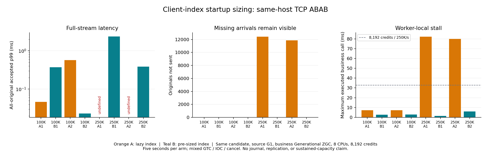

# Client-index startup sizing: repeated 250K/s finite acceptance

**Both 250K/s A/B pairs remove all missing acceptances.** With one frozen candidate, independent source G1 and business Generational ZGC, lazy sizing A1/A2 misses 12,438/11,874 originals. Explicit startup index sizing B1/B2 accepts all 1,250,000 commands each, with 0 not-sent, 0 business rejection and 0 unknown. Full-stream scheduled-to-reply p99 is 2.371786/0.385923 ms. Both source schedules satisfy the 20 ms bound and in-window accepted goodput improves in both pairs.

This is a five-second same-host loopback TCP screen, with no journal or replication. It establishes a repeatable finite improvement at 250K commands/s for this mixed fixture; it does not establish sustained 250K/s capacity or a production SLA. The [separate 30-minute replicated run](REPLICATED_SUSTAINED_R3_RESULTS.md) is 100/s on three same-host Aeron JVMs and fails its timing/latency gate.



## Complete ABAB results

|Rate/s|Arm|Accepted|Not sent|Rejected|Full-stream p99 ms|Full-stream p99.9 ms|Accepted in-window/s|Finite gate|
|---:|---|---:|---:|---:|---:|---:|---:|---|
|100000|A1|500000|0|0|0.046152|4.485926|99999.8|pass|
|100000|B1|500000|0|0|0.372368|7.928489|99999.8|pass|
|100000|A2|500000|0|0|0.573950|3.944522|100000.0|pass|
|100000|B2|500000|0|0|0.023047|5.941640|99999.8|pass|
|250000|A1|1237092|12438|470|undefined|undefined|247417.4|fail|
|250000|B1|1250000|0|0|2.371786|8.840573|249999.2|pass|
|250000|A2|1237648|11874|478|undefined|undefined|247529.0|fail|
|250000|B2|1250000|0|0|0.385923|5.464900|249999.8|pass|

A=default lazy client-index sizing; B=explicit expected-retained-order sizing. All arms have 0 unknown. Finite acceptance requires every planned command accepted, source lateness ≤ 20 ms and at least 99% confirmations before the five-second deadline; it is not an all-requests-before-deadline or millisecond SLA. The 250K B arms respectively confirm 1,249,996/1,249,999 before that deadline and drain the remaining 4/1 originals afterward. Their full distributions include all 1,250,000.

At 100K/s, p99 directions disagree: 0.046→0.372 ms and 0.574→0.023 ms. The second B also has one fewer in-window confirmation. There is no broad 100K performance win or automatic production-default promotion. The explicit hint remains opt-in and its memory/startup costs must be budgeted. Both 250K A distributions remain undefined for all-original accepted latency because some original commands were not sent; successful-only p99 is never substituted.

## The stall mechanism

The old diagnosis identified a default HashMap resize at 786,433 retained client-order IDs. The new matched intervention preserves all terminal orders, client IDs, balances, price-time rules, cached results, source credits, wire framing, CPU affinity and heap ceilings. It only requests initial index capacity before arrivals, bounded by the existing retention limit. Existing constructors and production defaults retain lazy sizing; the hint does not change snapshot bytes.

|250K arm|Call at original index 1,089,073 / retained count 786,433|Largest executed business call|Peak outstanding credits|
|---|---:|---:|---:|
|A1|82228.260 µs|82.228 ms|8192|
|B1|0.580 µs|1.398 ms|2499|
|A2|79822.776 µs|79.823 ms|8192|
|B2|1.549 µs|6.011 ms|1667|

All four arms have an identical, complete accepted-result prefix through that original: 1,089,074 commands, with no omitted/rejected prefix command. The complete input corpus and prefix outcome hashes agree. Thus the compared call is not moved to a different business history after early loss. The full independent Java/Python trade and balance replays are separately retained for every arm. The repeated threshold-specific disappearance after changing only sizing strongly supports client-index resize as the major 250K credit-exhaustion mechanism. It does not attribute every remaining tail to that map.

At 250K/s, 8192 credits represent 32.768 ms of planned arrivals. The A resize takes ~80 ms, exhausts those credits and causes real not-sent originals. B keeps the same credit bound; it does not hide a stall behind a larger queue. All four 250K arms have 0 zero-byte source socket writes, although this alone would not exclude kernel/server queueing. Business-call durations use the worker's clock; all end-to-end timing uses the source's clock. No cross-JVM nanoTime subtraction is used.

The 1.25M-command fixture contains 701578 GTC, 199917 IOC and 348505 cancel commands, with 485480 fills in the complete accepted flow, 118889 multi-fill commands, 28666 partial IOC commands, 64 initial price levels per side and 1024 initial resting orders. Live-book occupancy ranges 501–1025. This is not a million-live-order, native-amend or multi-market benchmark. The expanded index retains terminal IDs.

## Correctness, raw evidence and reproduction

The code change passes 61 core tests, 10 comparison tests and 518 cluster tests locally, all with 0 failures/errors/skips. The exact Linux candidate passes 12 targeted Java tests (including actual child processes and sizing/duplicate/snapshot compatibility), plus the existing 3 Python auditor tests. Two native functional controls and all 8 performance arms complete full independent original-command/fill/account/book audits.

The 8 arms retain 7M planned originals: 6,974,740 accepted, 24,312 not sent, 948 valid business rejections and 0 unknown. Missing planned GTC commands can lead to later cancel rejection; the oracle replays the actual received subset. Each original archive is member-hashed and fully authenticated-download checked. The 8 performance assets contain 389,533,876 compressed bytes. Qualification also archives the exact runtime/test binaries. Large raw files remain in the private repository's draft attachments rather than Git blobs.

One metadata download failed while collecting 100K B2; collection resumed against the same stopped original and asset. It was not a benchmark retry. The failure and closure receipts remain in the [thin evidence](../evidence/2026-10-27/client-index-sizing-r1/). The [original-prefix check](../evidence/2026-10-27/client-index-sizing-r1/diagnosis/PREFIX_EQUIVALENCE.json) binds the retained-count diagnosis to the downloaded source member hashes.

See the [registered protocol and portable launcher](CLIENT_INDEX_SIZING_PROTOCOL.md). Rebuild the receipt summary with:

```sh
python3 scripts/summarize-client-index-sizing.py evidence/2026-10-27/client-index-sizing-r1 --output /tmp/sizing-summary.json
```

The summary verifies qualification binary hashes, original result hashes, fixed candidate/boot/CPU/heap/collector, corpus identity, chronological ABAB order, credit limits, complete accounting and private archive receipts. `scripts/diagnose-client-index-stalls.py` independently locates original worker calls at retained-index boundaries; it does not rerun the benchmark.

[Final process closure](../evidence/2026-10-27/client-index-sizing-r1/POST_CAMPAIGN_QUIET.json) confirms both finite cohorts' original workers and all qualification/endurance/recovery JVMs inactive, no Java processes left, and 4.34 GB free. No new paid cloud resource was created. The existing CPU remains running.
