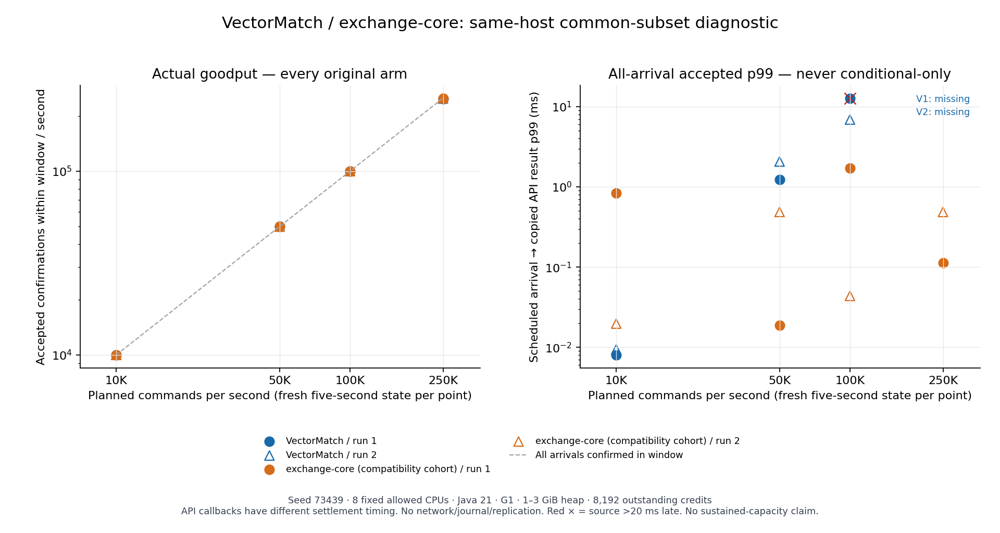

# Common-subset same-host API results — 2026-10-27

**All 16 preregistered five-second arms are closed and independently replayed.** VectorMatch passes both finite gates at 10k and 50k planned commands/s, one of two at 100k, and neither at 250k. The exchange-core compatibility cohort passes all eight finite gates. These observations establish neither steady-state capacity nor an equivalent-settlement engine ranking.

There are 8,200,000 planned arrivals across independent fresh-state experiments, 8,180,931 accepted, 17,420 not sent, 1,649 business rejections and **zero unknowns**. The counts are not a continuous 8.2M business lineage. The original 100M lineage remains a separate experiment. All missing acceptances occur in the two VectorMatch 250k arms; their all-arrival accepted p99 is undefined.



## Scope and comparability

- Frozen application source `f3cba7c0190a4a7acb37f015c6eb73c252c2466f`; [protocol](COMMON_ENGINE_COMPARISON_PROTOCOL.md), [artifact hashes](../evidence/2026-10-27/common-comparison-r1/preparation/CANDIDATE.json), [verified structured summary](../evidence/2026-10-27/common-comparison-r1/SUMMARY.json). No source or parameter changes between measured arms.
- Same existing Runpod CPU container, same boot, reported AMD EPYC 9575F, eight fixed allowed logical CPUs `0,2,7,10,12,19,24,26`. This is a shared-host allocation, not verified exclusive physical cores. Java 21.0.13+9, G1, 1–3 GiB heap, ActiveProcessorCount=8, 8,192 total outstanding credits, seed 73439.
- Normal integer spot accounting, one market, 16 synthetic funded accounts, 1,024 initial resting orders, 64 initial price levels per side. Common GTC/IOC/cancel flow includes partial fills and multiple makers per IOC. No native amend, self-trade, multi-market, network, journal or replication.
- **Scheduled arrival → copied native API result** includes source lateness, the common queue, adapter allocation/copy and business processing. VectorMatch also retains terminal orders and a bounded native duplicate-result cache. exchange-core uses its own risk/matching pipeline. These are deliberately disclosed architecture/semantics differences.
- The released exchange-core 0.5.3 engine JAR is unchanged, but its stock Chronicle dependency cannot initialize on Java 21. The explicit public Chronicle BOM 2.25ea60 compatibility cohort is measured. Stock-Java21 and unavailable-BOM failures remain in local-qualification evidence; this is not a reproduction of the upstream published benchmark.
- **Native callback settlement positions differ:** the released exchange-core result handler depends on matching, while risk release can run in parallel. VectorMatch returns after synchronous account changes. Final balances agree after completion, but that does not make earlier callbacks equivalent settlement acknowledgements. [Exact release-source review](../evidence/2026-10-27/common-comparison-r1/API_BOUNDARY_REVIEW.json).
- Separate 10k-command warmup, generation, setup and replay occur outside the arrival window. Five seconds is too short to establish thermal/JIT/GC steady state or a 30–60 minute SLA. Different orders of magnitude in individual repeats are retained, not averaged into a winner.

## Every original count and goodput

At each rate the order is VectorMatch A1, exchange-core B1, VectorMatch A2, exchange-core B2. Goodput counts **accepted callbacks inside the original five-second window**, not successes divided by a convenient post-drain interval. All arms have zero unknowns.

| Original | Planned | Accepted | Not sent | Business rejected | In-window accepted/s | Finite gate |
|---|---:|---:|---:|---:|---:|---|
| 10000-a1 | 50,000 | 50,000 | 0 | 0 | 10,000.0 | PASS |
| 10000-b1 | 50,000 | 50,000 | 0 | 0 | 10,000.0 | PASS |
| 10000-a2 | 50,000 | 50,000 | 0 | 0 | 10,000.0 | PASS |
| 10000-b2 | 50,000 | 50,000 | 0 | 0 | 10,000.0 | PASS |
| 50000-a1 | 250,000 | 250,000 | 0 | 0 | 50,000.0 | PASS |
| 50000-b1 | 250,000 | 250,000 | 0 | 0 | 50,000.0 | PASS |
| 50000-a2 | 250,000 | 250,000 | 0 | 0 | 50,000.0 | PASS |
| 50000-b2 | 250,000 | 250,000 | 0 | 0 | 50,000.0 | PASS |
| 100000-a1 | 500,000 | 500,000 | 0 | 0 | 100,000.0 | FAIL |
| 100000-b1 | 500,000 | 500,000 | 0 | 0 | 100,000.0 | PASS |
| 100000-a2 | 500,000 | 500,000 | 0 | 0 | 100,000.0 | PASS |
| 100000-b2 | 500,000 | 500,000 | 0 | 0 | 100,000.0 | PASS |
| 250000-a1 | 1,250,000 | 1,237,671 | 11,351 | 978 | 247,534.2 | FAIL |
| 250000-b1 | 1,250,000 | 1,250,000 | 0 | 0 | 249,999.4 | PASS |
| 250000-a2 | 1,250,000 | 1,243,260 | 6,069 | 671 | 248,652.0 | FAIL |
| 250000-b2 | 1,250,000 | 1,250,000 | 0 | 0 | 250,000.0 | PASS |

## All-arrival tails and dispatch diagnostics

All latency columns below use **milliseconds**. `—` means an all-arrival accepted distribution does not exist. Publisher→result p99 is conditional on received replies (including business rejections) and cannot replace the missing global number. P50 is retained even where P99.9 exposes substantial stalls.

| Original | Global P50 | Global P99 | Global P99.9 | Publisher→result P99 | Maximum source lateness |
|---|---:|---:|---:|---:|---:|---:|
| 10000-a1 | 0.002241 | 0.008027 | 11.473310 | 0.002850 | 16.259242 |
| 10000-b1 | 0.007230 | 0.833160 | 3.060850 | 0.601664 | 1.526067 |
| 10000-a2 | 0.002099 | 0.009399 | 2.880024 | 0.002580 | 7.659286 |
| 10000-b2 | 0.003469 | 0.019704 | 3.419477 | 0.007170 | 3.096311 |
| 50000-a1 | 0.002076 | 1.236245 | 13.570702 | 0.001870 | 14.563291 |
| 50000-b1 | 0.003264 | 0.018910 | 2.526805 | 0.004620 | 5.193630 |
| 50000-a2 | 0.001934 | 2.069376 | 15.296550 | 0.001920 | 18.724963 |
| 50000-b2 | 0.002437 | 0.486820 | 5.246698 | 0.007690 | 5.537302 |
| 100000-a1 | 0.001985 | 12.789875 | 24.920443 | 0.002260 | 25.952897 |
| 100000-b1 | 0.002598 | 1.708473 | 8.422278 | 0.058110 | 9.593261 |
| 100000-a2 | 0.002231 | 6.907150 | 16.997680 | 0.002400 | 18.817668 |
| 100000-b2 | 0.003101 | 0.043700 | 2.723080 | 0.026650 | 4.407753 |
| 250000-a1 | — | — | — | 0.003060 | 76.242795 |
| 250000-b1 | 0.002911 | 0.113499 | 4.067846 | 0.044840 | 6.017372 |
| 250000-a2 | — | — | — | 0.002100 | 56.136781 |
| 250000-b2 | 0.002345 | 0.486606 | 3.908137 | 0.459545 | 0.285354 |

The finite gate requires all planned commands accepted, at least 99% confirmed in-window, and no source release over 20ms late. It contains **no latency SLA**. At 100k, A1 accepts everything but has 25.953ms maximum source lateness and fails; A2 passes. At 250k, both VectorMatch points miss planned acceptances and violate the timing gate. This does not locate an exact server ceiling: source scheduling, the shared credit window, GC and application work remain coupled in one JVM.

At 50k, VectorMatch has four measured/coarse-window young collections per arm (45/52ms collector elapsed total), versus one per arm (5/5ms) for the exchange-core cohort. This is a profiling lead, **not a causal GC attribution**. No per-thread allocation profile or source-isolation intervention has yet established why each tail occurs.

## Planned workload and resource records

Workload SHA-256 is identical across all four arms at each rate. Independent full-acceptance trade files also match byte-for-byte. The state-aware generator replenishes the book, so the realized GTC/IOC/cancel proportions differ from its unconstrained random selector. The counts below describe the frozen complete plan, not an invented execution of unsent orders.

| Rate | GTC | IOC | Cancel | Planned multi-fill commands | Planned partial IOC | Live-order min–max |
|---|---:|---:|---:|---:|---:|---|
| 10,000 | 27,850 | 7,956 | 14,194 | 4,728 | 1,138 | 502–1025 |
| 50,000 | 140,060 | 40,081 | 69,859 | 23,809 | 5,763 | 502–1025 |
| 100,000 | 280,237 | 80,036 | 139,727 | 47,430 | 11,536 | 501–1025 |
| 250,000 | 701,578 | 199,917 | 348,505 | 118,889 | 28,666 | 501–1025 |

| Original | Coarse process CPU seconds | GC collections / elapsed ms | Sampled max queued / outstanding |
|---|---:|---|---|
| 10000-a1 | 10.560 | 1 / 17 | 1 / 1 |
| 10000-b1 | 30.510 | 0 / 0 | 1 / 1 |
| 10000-a2 | 10.530 | 1 / 8 | 1 / 1 |
| 10000-b2 | 30.670 | 0 / 0 | 1 / 1 |
| 50000-a1 | 10.700 | 4 / 45 | 1 / 1 |
| 50000-b1 | 30.800 | 1 / 5 | 1 / 1 |
| 50000-a2 | 10.800 | 4 / 52 | 1 / 1 |
| 50000-b2 | 30.930 | 1 / 5 | 1 / 1 |
| 100000-a1 | 10.730 | 5 / 95 | 1 / 1 |
| 100000-b1 | 30.640 | 1 / 9 | 1 / 1 |
| 100000-a2 | 10.940 | 5 / 74 | 1 / 1 |
| 100000-b2 | 30.760 | 1 / 5 | 1 / 1 |
| 250000-a1 | 11.780 | 6 / 197 | 1 / 1 |
| 250000-b1 | 30.810 | 0 / 0 | 1 / 2 |
| 250000-a2 | 11.470 | 6 / 184 | 0 / 1 |
| 250000-b2 | 30.860 | 0 / 0 | 1 / 1 |

CPU/GC snapshots begin approximately 50ms before the scheduled origin and end after final state capture and engine shutdown. They include different amounts of post-result work and must not be used as per-order CPU efficiency. Queue values are one-second samples, not true maxima. Complete GC logs, process CPU/memory/I/O samples and every request timestamp are in the original assets. There is no disk-force metric because this experiment does not perform journal persistence in its measured path.

The queue sampler misses short bursts: it observes only 0–1 queued entries in the overloaded VectorMatch arms, although their NOT_SENT rows prove the 8,192-credit bound was exhausted at other instants. These samples cannot support a no-backlog claim. Finer sampling or an independently validated reconstruction from original admission/publisher/reply timestamps is an additional instrumentation task.

## Correctness and original evidence

- Six targeted Java tests and three Python auditor tests pass on the actual Linux candidate. The two 1k/s functional qualifications accept all 1,000 requests and produce the same 563-fill trade file. These are qualification points, not comparative timing evidence.
- Java flat-book replay and independent Python price-level/FIFO replay check every received original, exact maker/taker/price/quantity, remaining quantity, all open orders and every available/reserved balance. Overloaded points replay the actual received subset; missing planned commands never enter the oracle as if executed.
- The summary checks candidate, boot, affinity, JVM settings, workload hashes, every retained result/audit member hash, all-arrival accounting, original group closure and distinct private assets. Eight deliberately altered temporary receipt sets are refused (missing originals, changed bytes, affinity drift, forged global percentile, changed workload, reused asset, failed native, missing test). [Verification](../evidence/2026-10-27/common-comparison-r1/SUMMARY_CHECKS.json). This receipt verification complements, rather than substitutes for, the earlier full raw replay.
- Nineteen original private draft assets retain 1,184,617,909 raw file bytes, packaged in 339,662,967 compressed bytes. Every member and complete authenticated download was SHA-256 checked. Large originals live in private attachments; Git contains thin indexes and derived figures. The same-repository draft release is `423510304`; individual asset IDs/hashes are in the summary.
- One GitHub download was refused during collection of 50k B2. Collection resumed against the **same stopped original and same uploaded asset**; no native point was retried, removed or replaced. The original failure, resume controller and logs remain in [collection-resume](../evidence/2026-10-27/common-comparison-r1/collection-resume).
- [Post-campaign closure](../evidence/2026-10-27/common-comparison-r1/POST_CAMPAIGN_QUIET.json) confirms all 19 original workers inactive, no Java process left, and approximately 4.60GB free in the existing CPU container. No new paid resource was created; the pre-existing authorized CPU remains available.

## Reproduce and interpret

Use the build, explicit launcher and independent auditor in the [protocol](COMMON_ENGINE_COMPARISON_PROTOCOL.md). The launcher refuses existing evidence and removes inherited JVM flags. It was shell-checked with argument, environment-removal and overwrite-refusal checks; the native campaign used the separately frozen recorded worker.

```sh
python3 scripts/summarize-common-comparison.py evidence/2026-10-27/common-comparison-r1 --output NEW_SUMMARY.json
python3 scripts/plot-common-comparison.py NEW_SUMMARY.json NEW_FIGURE_DIRECTORY
```

The plot requires matplotlib (rendered here with 3.9.4); the full business auditor and receipt summarizer use only the Python standard library. To independently audit actual financial rows, download the private asset by its recorded ID, verify its SHA-256/member inventory, and run `scripts/audit-common-comparison.py` on its complete `native/` directory.

The next implementation gate is to separate arrival scheduling from application GC and profile allocations without changing business semantics, then run a fresh matched comparison. A streaming replicated adapter with bounded evidence rotation is still required for uninterrupted 30–60 minute tests and in-flight fault recovery. This campaign neither advances the earlier 13k cross-Pod capacity claim nor closes the [production acceptance gates](PRODUCTION_ACCEPTANCE.md).
