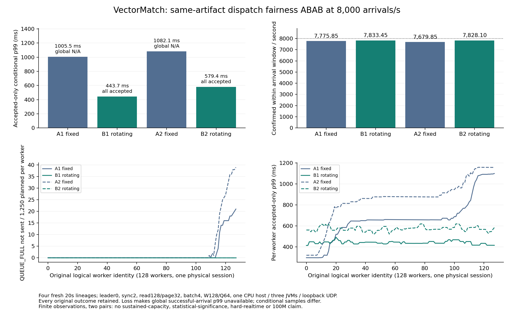

# Fixed/rotating dispatch fairness: complete CPU ABAB

This is a same-artifact fixed/rotating/fixed/rotating source-dispatch comparison at8,000 scheduled arrivals/s,not a sustained capacity result. Each fresh20s lineage has160,000 original arrivals. Every accepted,not-sent,rejected and unknown outcome is retained. Read the loss counts before comparing conditional latency distributions.

|Arm|Accepted /160,000|QUEUE_FULL notSent|Confirmed inside20s /s|All-arrival accepted p99 ms|Accepted-only conditional p99 ms|Sampled total queued high|
|---|---:|---:|---:|---:|---:|---:|
|A1 fixed|159795|205|7775.85|unavailable (loss)|1005.502113|4845|
|B1 rotating|160000|0|7833.45|443.672731|443.672731|3085|
|A2 fixed|159599|401|7679.85|unavailable (loss)|1082.098309|5700|
|B2 rotating|160000|0|7828.10|579.389303|579.389303|4168|

Server rejection and observed/final UNKNOWN are zero in all four arms. Global successful-arrival percentiles are unavailable whenever any planned request is missing. A lower accepted-only conditional p99 excludes those missing requests and cannot be reported as a global-p99 percentage improvement.

Pair1: rotating changes notSent by-205,in-window confirmed goodput by+57.60/s,and accepted-only conditional p99 by-561.829382ms. Accepted sets differ; global-p99 reduction is null.

Pair2: rotating changes notSent by-401,in-window confirmed goodput by+148.25/s,and accepted-only conditional p99 by-502.709006ms. Accepted sets differ; global-p99 reduction is null.

The per-worker observations below distinguish fairness from throughput. Each worker retains its original identity,1,250 scheduled arrivals,FIFO queue capacity64 and at most one pending logical order. Source rotation does not enlarge the client window,renew permits,remove durability or pause the arrival clock.

|Arm|Workers with loss|Max loss /worker|Individual queue high|Worst-best worker conditional p99 ms|After positive offer return p99 ms|Maintenance wall s|
|---|---:|---:|---:|---:|---:|---:|
|A1 fixed|14|21|64|800.957133|11.126540|10.460101|
|B1 rotating|0|0|32|78.273603|11.542076|10.214181|
|A2 fixed|18|39|64|836.235795|11.087890|10.640152|
|B2 rotating|0|0|40|96.490809|11.548686|10.378509|

The dispatch cursor resumes from the first worker deferred at a maintenance cut,or after the last entry taken. This addresses fixed zero-start ordering. The timestamp breakdown still combines client polling,loopback UDP,replication and service after positive publication-offer return;it is not physical-network RTT. Predispatch/maintenance overlap is descriptive rather than an isolated causal measurement. Changes in maintenance wall time and host noise must remain visible alongside the two pairs.

## Maintenance timing decomposition

|Arm|Maintenance wall s|Source-RPC interval union s|Writer payload write s|Writer payload force s|Writer readback+verification s|Residual s|
|---|---:|---:|---:|---:|---:|---:|
|A1 fixed|10.460101|4.497438|0.026091|0.268571|1.693408|3.974593|
|B1 rotating|10.214181|4.364790|0.026846|0.288696|1.616679|3.917169|
|A2 fixed|10.640152|4.375077|0.024553|0.287108|1.695432|4.257982|
|B2 rotating|10.378509|4.321179|0.026400|0.273554|1.685166|4.072209|

Overlapping source-RPC intervals are merged by union,not summed as wall time. Writer payload write/force/readback phases are awaited separately from RPC consumption. Residual includes coordinator verification/encoding,writer prevalidation and queue waits,raw IO,receipt-file write/force,lease overhead and uninstrumented time. Payload force time excludes the second force for its separate receipt file. These descriptions do not isolate hardware,CPU or network causality. In particular,the residual must not be labelled pure disk latency;it identifies where finer instrumentation is still needed.

All arms use source9ca02a49dd3ec272fabb69328a8994b9674f29f4 and actual four-JAR fingerprint679e202a28cdaa52c63335ed9bc032f1ac13c4072d5e2a36a72756b861090f66. Leader0,sync2,read128,page32,batch4,chunk6144,owner1ms,driver100us,W128/Q64,one physical session and the codec-derived resource/admission plan are identical. Three JVMs share one existing32-thread/64GB CPU container and loopback UDP. Original-PID all-member2s readiness gates bracket setup/5s warm-up. No JFR is attached. Fixed behavior remains the legacy default;rotation is an opt-in experiment.

76 local tests across16 suites precede the candidate. Each native arm has complete original closed-process/native archives,CSV,wire/frame/index/offer bodies,all160,000 original identity/result bindings and independent readiness-row review. All original members and actual private Git blobs are verified before the next arm. Candidate-codec decoding is not an independent matching oracle. Matching three checkpoint log lines is not a binary snapshot/cold-recovery proof.

## Original private evidence

- [A1 fixed complete originals](../evidence/2026-10-24/runpod-cpu/retention-dispatch-fairness-v3/cloud-arm-1-r1/README.md),private verified commit `3889f6907abde78a2ff857f01354537ab9c4ccc3`.
- [B1 rotating complete originals](../evidence/2026-10-24/runpod-cpu/retention-dispatch-fairness-v3/cloud-arm-2-r1/README.md),private verified commit `a5c470b44a814077d62bdc340e1fec8ebcf30aa2`.
- [A2 fixed complete originals](../evidence/2026-10-24/runpod-cpu/retention-dispatch-fairness-v3/cloud-arm-3-r1/README.md),private verified commit `a04403d05b7c960e4f45c2b5b4c7f98290c8e3a6`.
- [B2 rotating complete originals](../evidence/2026-10-24/runpod-cpu/retention-dispatch-fairness-v3/cloud-arm-4-r1/README.md),private verified commit `8feaf631de636ac007508e1e084109adc252236b`.

[Comparison,diagnostic,input hashes and full figure data](../evidence/2026-10-24/runpod-cpu/retention-dispatch-fairness-v3/abab-reporting-r1/README.md) retain both pairs and every worker,including losses and noise. [Predeclared candidate](DISPATCH_FAIRNESS_V3.md) and [prior all-member-ready curve](READY_READ128_CAPACITY_RESULTS.md) remain separately labelled.

Twenty-second windows and two pairs do not establish statistical significance or a sustained throughput ceiling. Any next rate curve needs explicit admitted presets,new homogeneous artifact qualification,all original outcomes and enough duration/repeats to assess backlog.100M continuous fresh orders,100M orders/s and100M physical connections remain unproved separate targets. [Continuous endurance design](CONTINUOUS_ENDURANCE_PLAN.md) documents the bounded-state and raw-retention work required before a single-lineage campaign.
