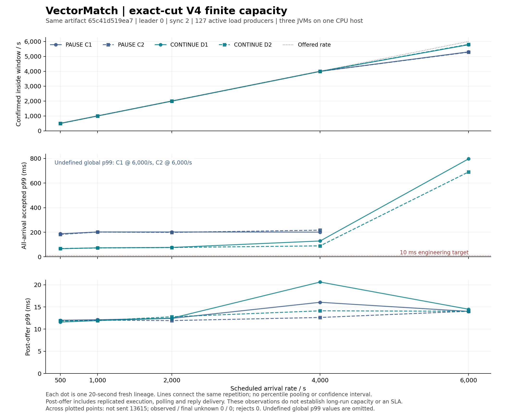

# Exact-cut V4 asynchronous-maintenance finite capacity results

Application source0c8303b250c61653eb1a0827ce54a67eab83e2a3; the exact Linux artifact is recorded in every common-configuration and original-point manifest. Full Linux correctness,442 Java/197 Python tests including11 PostgreSQL integration tests, actual compiled-body and454-file JDK equivalence, nineteen loaded origins and corrected checker qualification precede the fresh campaign. Hosted billing remains unresolved; the workflow uses the existing prepaid CPU.

[Prospective protocol](EXACT_CUT_CAPACITY_PROTOCOL_V4.md) fixes rates, policies, bounds and acceptance criteria. Every full raw point is a private-repository attachment with committed SHA and member inventory, authenticated re-download and complete verification. All previous79 runs and34 cohorts remain unchanged at the start of this campaign. Earlier artifact2ea38974 capacity and the disqualified1535-command cut are separate evidence; no old performance result transfers to this artifact.

## Completed coarse curve

The highest repeated passing tested rate is **4,000 scheduled arrivals/s**. The first failed tested rate is **6,000/s**. This brackets a finite-workload transition; it does not identify a precise sustained ceiling. All 20 points use the same compiled artifact, fixed leader 0, sync level 2 and configuration, with three actual UDP-connected JVMs on one physical CPU host.

At 6,000/s, PAUSE C1/C2 leave 6,720/6,895 of 120,000 scheduled orders unsent; their all-arrival p99 is undefined. CONTINUE D1/D2 eventually accept all 120,000, but in-window goodput is only 5,779.9/5,803.5 per second and global p99 is 796.814/690.515 ms. Both fail the prospective gate requiring at least 99% of scheduled throughput inside the 20-second arrival window. Upward escalation stopped. Across all points, observed/final UNKNOWN and server rejection are zero; these facts do not erase unsent work or delayed completion.

Every point passes financial reconciliation, exact archive cuts, receipt/event audit, canonical physical-order replay and all three snapshots/cold restores. Those are correctness checks, separate from failed capacity gates. None meets the 10 ms global p99 engineering target. CONTINUE reduces global p99 against PAUSE in these observations, but the full registered paired criterion is inconsistent across rates, so no default optimization is promoted.

[Figure provenance, original Git report references and regeneration script](../evidence/2026-10-26/runpod-cpu/async-capacity-v4/exact-cut-r2/complete-coarse-curve-r1/README.md). [Qualified read-only diagnostic probe](../evidence/2026-10-26/runpod-cpu/async-capacity-v4/exact-cut-r2/readonly-counter-probe-qualification-r1/README.md) is available for the next explicitly instrumented experiment; it has not yet profiled these workloads.

## 500 scheduled arrivals/s

All four arms use the same compiled artifact and fixed leader/configuration. These are separate20-second fresh lineages on one physical CPU.

| Arm | Policy | Accepted/planned | In-window goodput/s | End-to-end p50 ms | End-to-end p99 ms | Post-offer p99 ms | notSent | UNKNOWN final |
| --- | --- | --- | --- | --- | --- | --- | --- | --- |
| C1 | PAUSE | 10000/10000 | 499.8 | 8.173 | 187.522 | 11.998 | 0 | 0 |
| D1 | CONTINUE | 10000/10000 | 499.85 | 8.127 | 66.299 | 11.586 | 0 | 0 |
| C2 | PAUSE | 10000/10000 | 499.85 | 8.128 | 182.215 | 11.835 | 0 | 0 |
| D2 | CONTINUE | 10000/10000 | 499.8 | 8.157 | 67.375 | 11.893 | 0 | 0 |

All four prospective finite gates passed:True. Both registered paired direction criteria passed:False. Both candidates meet the10ms p99 target:False. No default performance promotion follows from these two pairs.

C1/D1:global p99 change -64.64464310035181%;post-offer p99 change -3.439632059092712%;in-window goodput difference 0.05000000000001137/s.
C2/D2:global p99 change -63.024317829972944%;post-offer p99 change 0.48651755751287773%;in-window goodput difference -0.05000000000001137/s.
Each original command/result,trade/event prefix,deadline,read credit and forced/readback receipt passed independent audit. The same adapter replays the actual positive physical-offer order and checks every received reply. All three snapshots and actual cold restores agree in every arm. Each full raw asset was authenticated,re-downloaded and every member byte/mode/owner/directory verified before progression.

Two pairs of finite20-second fresh lineages on one physical host;direction criterion is not statistical significance,endurance,SLA,independent-host durability,100M continuity or funded trading.

The next preregistered rate is 1000 only after this review is privately published. A failed finite gate stops upward escalation;conditional percentiles never replace undefined all-arrival p99.

## 1000 scheduled arrivals/s

All four arms use the same compiled artifact and fixed leader/configuration. These are separate20-second fresh lineages on one physical CPU.

| Arm | Policy | Accepted/planned | In-window goodput/s | End-to-end p50 ms | End-to-end p99 ms | Post-offer p99 ms | notSent | UNKNOWN final |
| --- | --- | --- | --- | --- | --- | --- | --- | --- |
| C1 | PAUSE | 20000/20000 | 998.25 | 7.326 | 202.071 | 12.122 | 0 | 0 |
| D1 | CONTINUE | 20000/20000 | 998.25 | 7.175 | 73.233 | 11.927 | 0 | 0 |
| C2 | PAUSE | 20000/20000 | 998.25 | 7.242 | 201.759 | 12.028 | 0 | 0 |
| D2 | CONTINUE | 20000/20000 | 998.25 | 7.195 | 72.213 | 11.919 | 0 | 0 |

All four prospective finite gates passed:True. Both registered paired direction criteria passed:True. Both candidates meet the10ms p99 target:False. No default performance promotion follows from these two pairs.

C1/D1:global p99 change -63.758800258311666%;post-offer p99 change -1.6045171360123511%;in-window goodput difference 0.0/s.
C2/D2:global p99 change -64.20826214783425%;post-offer p99 change -0.9098420957810882%;in-window goodput difference 0.0/s.
Each original command/result,trade/event prefix,deadline,read credit and forced/readback receipt passed independent audit. The same adapter replays the actual positive physical-offer order and checks every received reply. All three snapshots and actual cold restores agree in every arm. Each full raw asset was authenticated,re-downloaded and every member byte/mode/owner/directory verified before progression.

Two pairs of finite20-second fresh lineages on one physical host;direction criterion is not statistical significance,endurance,SLA,independent-host durability,100M continuity or funded trading.

The next preregistered rate is 2000 only after this review is privately published. A failed finite gate stops upward escalation;conditional percentiles never replace undefined all-arrival p99.

[Read-only queue-wait diagnosis at500/s](EXACT_CUT_QUEUE_DIAGNOSTIC_V4.md) separates recorded phase overlap from a causal or higher-rate bottleneck claim.

## 2000 scheduled arrivals/s

All four arms use the same compiled artifact and fixed leader/configuration. These are separate20-second fresh lineages on one physical CPU.

| Arm | Policy | Accepted/planned | In-window goodput/s | End-to-end p50 ms | End-to-end p99 ms | Post-offer p99 ms | notSent | UNKNOWN final |
| --- | --- | --- | --- | --- | --- | --- | --- | --- |
| C1 | PAUSE | 40000/40000 | 1996.65 | 7.626 | 202.138 | 12.420 | 0 | 0 |
| D1 | CONTINUE | 40000/40000 | 1996.65 | 7.598 | 76.332 | 12.466 | 0 | 0 |
| C2 | PAUSE | 40000/40000 | 1996.65 | 7.593 | 198.853 | 11.925 | 0 | 0 |
| D2 | CONTINUE | 40000/40000 | 1996.65 | 7.292 | 76.039 | 12.783 | 0 | 0 |

All four prospective finite gates passed:True. Both registered paired direction criteria passed:False. Both candidates meet the10ms p99 target:False. No default performance promotion follows from these two pairs.

C1/D1:global p99 change -62.23789771615296%;post-offer p99 change 0.3710068295562641%;in-window goodput difference 0.0/s.
C2/D2:global p99 change -61.761096372612045%;post-offer p99 change 7.190311263742055%;in-window goodput difference 0.0/s.
Each original command/result,trade/event prefix,deadline,read credit and forced/readback receipt passed independent audit. The same adapter replays the actual positive physical-offer order and checks every received reply. All three snapshots and actual cold restores agree in every arm. Each full raw asset was authenticated,re-downloaded and every member byte/mode/owner/directory verified before progression.

Two pairs of finite20-second fresh lineages on one physical host;direction criterion is not statistical significance,endurance,SLA,independent-host durability,100M continuity or funded trading.

The next preregistered rate is 4000 only after this review is privately published. A failed finite gate stops upward escalation;conditional percentiles never replace undefined all-arrival p99.

## 4000 scheduled arrivals/s

All four arms use the same compiled artifact and fixed leader/configuration. These are separate20-second fresh lineages on one physical CPU.

| Arm | Policy | Accepted/planned | In-window goodput/s | End-to-end p50 ms | End-to-end p99 ms | Post-offer p99 ms | notSent | UNKNOWN final |
| --- | --- | --- | --- | --- | --- | --- | --- | --- |
| C1 | PAUSE | 80000/80000 | 3993.45 | 55.206 | 200.988 | 16.047 | 0 | 0 |
| D1 | CONTINUE | 80000/80000 | 3993.45 | 27.403 | 128.860 | 20.616 | 0 | 0 |
| C2 | PAUSE | 80000/80000 | 3993.45 | 56.483 | 216.867 | 12.629 | 0 | 0 |
| D2 | CONTINUE | 80000/80000 | 3993.45 | 17.755 | 89.341 | 14.127 | 0 | 0 |

All four prospective finite gates passed:True. Both registered paired direction criteria passed:False. Both candidates meet the10ms p99 target:False. No default performance promotion follows from these two pairs.

C1/D1:global p99 change -35.88670819610987%;post-offer p99 change 28.466672545101666%;in-window goodput difference 0.0/s.
C2/D2:global p99 change -58.803620461275386%;post-offer p99 change 11.866836280794523%;in-window goodput difference 0.0/s.
Each original command/result,trade/event prefix,deadline,read credit and forced/readback receipt passed independent audit. The same adapter replays the actual positive physical-offer order and checks every received reply. All three snapshots and actual cold restores agree in every arm. Each full raw asset was authenticated,re-downloaded and every member byte/mode/owner/directory verified before progression.

Two pairs of finite20-second fresh lineages on one physical host;direction criterion is not statistical significance,endurance,SLA,independent-host durability,100M continuity or funded trading.

The next preregistered rate is 6000 only after this review is privately published. A failed finite gate stops upward escalation;conditional percentiles never replace undefined all-arrival p99.

## 6000 scheduled arrivals/s

All four arms use the same compiled artifact and fixed leader/configuration. These are separate20-second fresh lineages on one physical CPU.

| Arm | Policy | Accepted/planned | In-window goodput/s | End-to-end p50 ms | End-to-end p99 ms | Post-offer p99 ms | notSent | UNKNOWN final |
| --- | --- | --- | --- | --- | --- | --- | --- | --- |
| C1 | PAUSE | 113280/120000 | 5299.05 | 1361.665 | undefined | 13.996 | 6720 | 0 |
| D1 | CONTINUE | 120000/120000 | 5779.9 | 677.153 | 796.814 | 14.485 | 0 | 0 |
| C2 | PAUSE | 113105/120000 | 5281.2 | 1367.848 | undefined | 14.035 | 6895 | 0 |
| D2 | CONTINUE | 120000/120000 | 5803.5 | 590.032 | 690.515 | 14.027 | 0 | 0 |

All four prospective finite gates passed:False. Both registered paired direction criteria passed:False. Both candidates meet the10ms p99 target:False. No default performance promotion follows from these two pairs.

C1/D1:global p99 change None%;post-offer p99 change 3.4910478194829953%;in-window goodput difference 480.84999999999945/s.
C2/D2:global p99 change None%;post-offer p99 change -0.05970685643471585%;in-window goodput difference 522.3000000000002/s.
Each original command/result,trade/event prefix,deadline,read credit and forced/readback receipt passed independent audit. The same adapter replays the actual positive physical-offer order and checks every received reply. All three snapshots and actual cold restores agree in every arm. Each full raw asset was authenticated,re-downloaded and every member byte/mode/owner/directory verified before progression.

Two pairs of finite20-second fresh lineages on one physical host;direction criterion is not statistical significance,endurance,SLA,independent-host durability,100M continuity or funded trading.

The next preregistered rate is None only after this review is privately published. A failed finite gate stops upward escalation;conditional percentiles never replace undefined all-arrival p99.
