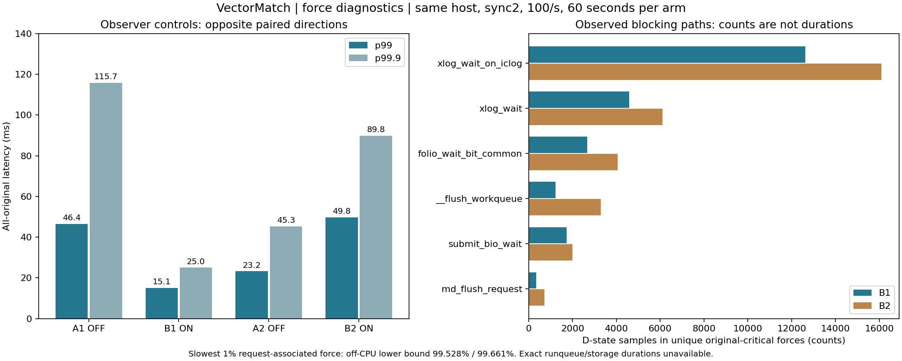

# Force wait decomposition: filesystem blocking observed, exact scheduler duration unavailable

Six original arms on the existing CPU are closed and privately archived. Both observer-ON arms join every original request to the exact recording force, thread CPU/resource envelope and in-force state samples. The evidence favors filesystem synchronization blocking as the main cause of the observed force tails. It does **not** measure a physical disk service time or an exact storage/runqueue split.

| Original arm | Force observer | Planned / accepted | Full p99 ms | Full p99.9 ms | Absolute gate |
|---|---|---:|---:|---:|---|
| A1 | OFF | 6,000 / 6,000 | 46.397 | 115.737 | fail |
| B1 | ON | 6,000 / 6,000 | 15.056 | 25.000 | pass |
| A2 | OFF | 6,000 / 6,000 | 23.189 | 45.264 | pass |
| B2 | ON | 6,000 / 6,000 | 49.761 | 89.768 | fail |

Each arm lasts 60 seconds at 100/s. Two additional 20-request functional arms also pass correctness. All 24,040 requests are accepted, without unknown, rejection or unsent outcomes. All stage sums and canonical states verify. This is a same-host, three-replica diagnostic at low load with leader 0, G1, fixed affinity, 1 ms parks, overlay storage and **sync2** throughout. It is not a capacity or independent-fault-domain test.



## What force is doing

For the slowest 1% of end-to-end requests, the thread CPU counter bounds show at least **99.528% (B1)** and **99.661% (B2)** of the associated force wall time is off CPU. These are request-weighted force intervals; a batched force can serve multiple requests. Unique-force state counts are also retained separately.

Within those intervals, **98.485% / 99.536% of valid state samples** observe D state. Sampled wait locations include `xlog_wait_on_iclog`, `xlog_wait`, `__flush_workqueue`, `folio_wait_bit_common`, `submit_bio_wait` and `md_flush_request`. D-state proportions are **sample counts, not measured time percentages**. Linux's [XFS log code](https://github.com/torvalds/linux/blob/v6.8/fs/xfs/xfs_log.c) associates `xlog_wait_on_iclog` with log synchronization completion.

One B2 request takes 117.462 ms end to end. Its critical force takes 66.751 ms, with CPU time at most 0.0742 ms and off-CPU time bounded between 66.6771 and 66.6847 ms. Of 104 valid samples, 103 observe D state, one is a transition and none observes R. This strongly identifies blocking in this force; it does not establish zero wakeup/runqueue delay. The same request also spends 35.695 ms in ACK delivery, so force is not its only delay.

The kernel has schedstats and task delay accounting disabled, rejects own-process perf counters, and exposes no accessible tracefs. Thus **exact runnable-wait and storage-wait nanoseconds remain null**. R samples mean running or runnable. Context-switch counts are not durations. No host-wide settings were changed.

There is also queue amplification: for the slowest 1% of requests, archive-delivery/poll waiting consumes 21.070% / 43.515% of full latency. **93.519% / 99.849% of that waiting overlaps an earlier force on the same recording.** This supports head-of-line blocking behind the synchronous recorder. Overlap is a temporal observation, not proof of an exact packet-arrival time or exclusion of scheduling delay. Recomputed input hashes and complete figures are retained in each ON arm's `PRIOR_FORCE_OVERLAP.json`.

## Observer effect and next hypothesis

ON/OFF p99 ratios are **0.325 and 2.146**, with p99.9 ratios **0.216 and 1.983**. Mean process CPU cores sum to 0.617→0.717 and 0.662→0.684. The inconsistent latency direction does not establish negligible probe overhead or a performance improvement. Both sides of the next optimization experiment must carry identical probes.

The next hypothesis is to fully write and sync fresh recording segments before traffic, reducing allocation/unwritten-extent work during subsequent writes. This differs from the previous failed `fallocate(KEEP_SIZE)` experiment. It may still fail because data writes and XFS log ordering continue under sync2. Its own protocol and ABAB must decide; no default or endurance candidate has been selected here.

## Audit and reproduction

- [Frozen observer protocol](FORCE_WAIT_PROTOCOL.md)
- [Summary, all original results and private archive identities](../evidence/2026-10-27/force-wait-decomposition-r1/SUMMARY.json)
- [Owned-process closure](../evidence/2026-10-27/force-wait-decomposition-r1/POST_CAMPAIGN.json): all 24 test JVMs closed; existing CPU retained.
- Raw CSV, JFR, GC, launch data, binaries and final state are in six private release assets; authenticated full downloads and every member hash verified before remote duplicate retirement.
- Candidate source `839cf1a809865baf5a3c0f7a805f28980fc38f0c`; native qualification preserves all 128 test forces; 529 cluster tests passed before the observer campaign.

```sh
python3 scripts/summarize-force-wait.py evidence/2026-10-27/force-wait-decomposition-r1 --output /tmp/force-wait-summary.json
```

Both ON arms were also fetched again and re-audited locally from all original native CSV files. The 6,000-row force-attribution CSV for each arm is **byte-identical** to its archived counterpart, and all aggregate fields match. The fetch verifies all 113 members per archive even though it extracts only attribution inputs.

```sh
python3 scripts/fetch-replicated-evidence.py evidence/2026-10-27/force-wait-decomposition-r1/observer-b1 /tmp/force-b1 --include-force
python3 scripts/replay-force-wait.py /tmp/force-b1 evidence/2026-10-27/force-wait-decomposition-r1/observer-b1 --output /tmp/force-b1-replay.json
```
