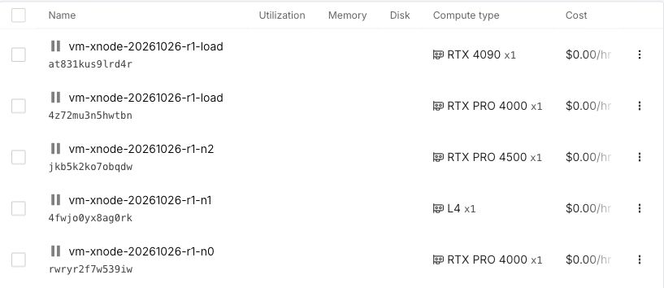

# Private-UDP cross-Pod matching and recovery, 2026-10-26

Three real Runpod Pods replicated synthetic matching commands over native private
UDP, with a fourth Pod generating load. Ten finite trials retained **490,000
planned requests: 489,997 accepted, three client-queue-full not sent, zero initial
or final unknown**. The highest original rate passing both registered finite
100ms-p99/99%-goodput gates is **4,000/s**. A hard throughput ceiling is not established:
8,000/s accepted every request but had inconsistent tails, and a separate 6,000/s
comparison also exposed substantial variance. The idle-policy candidate is not promoted.

All four running test roles and the failed replacement predecessor were stopped
before 09:27 UTC, before the 09:30 deadline. Each shows $0/hour idle cost. Conservative
incremental compute-plus-disk cost is **$2.062**, including provider initialization
and the failed instance, against the authorized $3 cap. This is an estimate, not an
invoice; the existing prepaid CPU and unrelated workloads are excluded and untouched.

## Exact path and configuration

Qualified source `97db58e20f8dc52bde9be7b5ca7fe469b212da9a`, full CI28
`40277635260`, unchanged artifact fingerprint
`a21a720ddfd479faf1129176bc2ff1adff2e34084874ca621999a4cdb4ffe3f3`.
Every Pod's four JARs, vendor JDK archive and all 454 JDK files/links were verified.
The JDK is Temurin 21.0.13+9. GPU computation was not used.

- Leader 0, three replicas, sync level 2, 2GiB heap per JVM, shared drivers.
- State `capacity-190k-v1`, client `extended-190k-128`, outbox 524,288.
- One multiplexed client session, 128 logical workers, 64 queue slots per worker.
- Request deadline 2s, drain 30s, scheduler lateness gate 20ms.
- MTU 1248, observed interface MTU 1300, requested receive buffer 128KiB.
- Each arm starts fresh, has 100 warmup commands and a ten-second arrival window.
  Twelve-second session-reap pauses and full final reference replay are outside it.
- MatchingClusteredService with retained bounded outbox; no PostgreSQL projector
  or V3/V4 archive-retention maintenance runs in this cohort. These results do not
  replace the maintenance-path or earlier three-Pod curves.

All four observed boot IDs and public/private addresses differ. The hardware is
heterogeneous: actual cgroup CPU quotas are 10.2/5.1/23.8 cores for the replicas and
13.6 for the generator. Neither separate physical power/disk domains nor dedicated
physical cores were established. No synchronized-clock one-way latency is claimed.
The provider private interface has a 100Mbps TBF shaper. HMAC-authenticated
96/512/1248-byte, no-fragment preflights passed between the load Pod and every replica
in both directions. Actual matching, not echo traffic, supplies the results below.

## Original fixed-configuration curve

All six trials have valid generator timing, unchanged leader 0, zero business/server
rejection, zero not-sent, zero initial/final unknown, and full canonical state,
asset-conservation and per-reply replay checks. All 18 closed replica recording logs
contain only leadership term 0. Quantiles use nearest rank over every scheduled
request's planned arrival to confirmed accepted reply, including client queueing.

| Planned/s | Requests per repeat | In-window accepted/s, r1 / r2 | All-offered p99 ms, r1 / r2 | Both registered gates |
| ---: | ---: | ---: | ---: | --- |
| 500 | 5,000 | 499.3 / 499.4 | 20.071 / 23.159 | pass |
| 4,000 | 40,000 | 3,993.5 / 3,996.9 | 19.841 / 15.509 | pass |
| 8,000 | 80,000 | 7,994.2 / 7,988.5 | 204.533 / 26.429 | fail |

At 8,000/s r1, queue p99 is 188.500ms and execute-through-resolution p99 is
17.473ms; the full distribution includes a much slower tail. This distinguishes
visible client queue accumulation from execution-call RTT; it does not prove that
client window size alone caused the stalls. The second repeat is much faster.
Rates above 8,000/s were not executed after the paired gate failed. These finite
observations establish neither sustained capacity nor a deterministic overload point.

The public SSH control connection briefly failed during the second 8,000/s run.
The four original remote processes continued. Reconnection recovered its original
successful validation, without rerunning the workload. Original observer failures,
partial progress, successful final result and recovery records are all retained;
SSH failure was not reclassified as business rejection or application overload.

## Separate single-factor A/B/A/B

All arms use 6,000/s, 60,000 arrivals and the same four Pods and qualified bytes.
A uses the default 1ms maximum data-path idle park. B sets only the three replicas'
`vectormatch.node.dataPathMaxParkNs=100000`; the client is unchanged.

| Arm | Accepted | Not sent | In-window accepted/s | All-offered p99 ms | Conditional accepted p99 ms |
| --- | ---: | ---: | ---: | ---: | ---: |
| A1 | 59,997 | 3 | 5198.1 | undefined | 1966.333 |
| B1 | 60,000 | 0 | 5994.3 | 549.846 | 549.846 |
| A2 | 60,000 | 0 | 5993.5 | 19.816 | 19.816 |
| B2 | 60,000 | 0 | 5994.5 | 16.845 | 16.845 |

All four arms pass correctness and generator-timing checks; all unknown counts are
zero. A1 has three queue-full originals, so its all-offered p99 is undefined.
B1 exceeds the 100ms gate. A2 to B2 improves p99 by 14.99%, below the preregistered
20% paired threshold; one faster pair would not establish repeatable improvement.
The candidate also uses more CPU. For the second pair, the three replicas consume
146.28 versus 199.62 CPU-seconds over their complete Java lifetimes, including
setup/warmup/load/validation; these are not load-only CPU measurements. Defaults
remain unchanged. The original outer observer refused B2 at its conservative start
margin; B2 ran once under the previously recorded eight-minute shutdown reserve.
That refusal and continuation are preserved, with no arm omitted or rerun.

The whole campaign's private TBF drop, overlimit and requeue counter deltas are
zero on all four Pods. This provides no evidence of hitting that 100Mbps shaper;
it does not exclude network delay, retransmission, host scheduling or storage/GC
stalls. Additional time-correlated profiling is needed to determine the pause's
root cause. The earlier instrumented V4 force-call evidence is a separate cohort.

## Actual fault and recovery checks

A separate lineage, with appointed-leader override removed, completed:

1. Validated matching and identical-byte state comparison with the functional
   client sharing replica Pod 1. This is not independent-generator capacity.
2. SIGKILL of the owned leader JVM, leader 2 to 0, canonical state verification,
   identical-key replay and conflicting-payload rejection without mutation.
3. Restart of that replica and all-three catch-up at the same observed term/position.
4. Snapshot request, all-three-JVM stop, cold restart from the same mounted files,
   full canonical verification and replay, followed by new accepted trades.

The 18.56-second controller recovery probe includes SSH dispatch, client JVM startup,
connection, snapshot and replay checks. It is not isolated election time or
first-new-order RTO. The fault occurs between validated writer phases, not during
an ongoing load. Mounted ephemeral disks survive these JVM faults; physical power,
disk and entire-Pod loss were not tested. All orders/accounts/funds are synthetic.

## Evidence, tests and offline reproduction

[Evidence index](../evidence/2026-10-26/runpod-private-cross-node/r1/README.md) contains
original registrations, failed observers, derived audits, exact Pod identities,
all-member SHA inventories, stop/cost proofs and private attachment IDs. Four raw
node archives total 110,845,335 bytes and contain 988 members. Every archive/member
was hashed locally; every uploaded asset was fully authenticated-downloaded and
its complete SHA/size reverified. Credentials, SSH private keys and preflight HMAC
keys are excluded. Full archives stay outside Git history.

The new [offline auditor](../scripts/audit-private-cross-node.py) checks immutable
archive/member identity, deployed provenance, fixed configuration, every original
capacity outcome, count, p99 and backlog through the existing reference analyzer.
Seven new archive-boundary tests and 38 existing analyzer tests pass locally; all
seven new tests also pass on the actual prepaid Linux CPU Pod (Python 3.8.10).
These are targeted tests, not a new full Java/PostgreSQL/Web or hosted-CI pass.
The independent audit identifies its own and the reference analyzer's source SHA.

This is finite replicated synthetic trading/recovery evidence. Continuous 100M
lineage, long-run latency, physical failure isolation and funded venue operation
remain separate acceptance gates. No production SLA or HFT certification is claimed.
