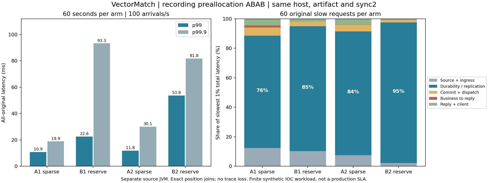

# Recording preallocation: both ABAB pairs regress

**Do not enable recording preallocation by default.** In this fixed-artifact experiment, the candidate's all-original p99 is 2.08× and 4.55× its paired baseline. Both pairs fail the pre-registered selection rule; no candidate endurance run or default promotion follows. This is a negative optimization result, preserved with every original request.

The preceding [stage attribution](REPLICATED_STAGE_TRACE_RESULTS.md) identified the durability/quorum wait as the dominant slow-request interval. This experiment tests one specific remedy: allocate a recording segment's disk blocks before traffic. It does not show that all forms of preallocation are slower on other filesystems or hardware, or isolate an exclusive physical cause for these shared-host stalls.

## Fixed configuration and original results

Source candidate `97a9076f53faaff7cda5b8bea6a6d928d9a45e9a`; existing prepaid CPU, three UDP replica JVMs and a separate load JVM on the **same host**. Both arms use identical binaries, G1, heap, CPU sets, appointed leader 0, 1 ms park, overlay storage, **sync2**, and full request tracing. Only `vectormatch.stage.preallocate=false/true` differs. Each arm is 60 seconds at 100 planned arrivals/s. Two prior functional arms each contain 20 requests.

|Arm|Recording allocation|Accepted|p50 ms|p99 ms|p99.9 ms|Maximum ms|Finite gate|
|---|---|---:|---:|---:|---:|---:|---|
|A1|Sparse, normal writer|6,000|8.070|10.857|18.915|41.234|Pass|
|B1|Startup allocation|6,000|8.161|22.570|93.279|135.917|Pass|
|A2|Sparse, normal writer|6,000|8.045|11.826|30.108|42.935|Pass|
|B2|Startup allocation|6,000|8.733|53.764|81.789|99.587|Fail: p99|

All **24,040** originals, including the functional arms, have correct final accepted results and complete exact-position stage joins. Zero not-sent, rejected or unknown; zero trace overflow. The four comparison canonical states are byte-identical. B2 confirms 5,999 within the scheduled window and the final original during drain; this request remains included in the full latency distribution. Maximum scheduled-but-unconfirmed counts are 5, 14, 5 and 10, and final unresolved backlog is zero.

Both pairs have worse p99 and p99.9: B/A ratios are **2.079 / 4.932** in pair 1 and **4.546 / 2.717** in pair 2. B1 passing the absolute finite gate does not make it an improvement. B2 fails the 25 ms p99 gate. Per the [frozen protocol](RECORDING_PREALLOCATION_PROTOCOL.md), the candidate 30-minute run is **not executed**. The earlier [30-minute baseline](REPLICATED_PATH_PROBE_RESULTS.md) remains separate evidence and is not superseded by these short arms.



## Slow requests remain dominated by durable replication

These percentages use the summed latency of each arm's slowest **60 original requests**, not differences or averages of marginal percentiles. The overlaps are subsets of archive waiting, and must not be added to that same wait a second time.

|Share of complete slow-tail latency|A1|B1|A2|B2|
|---|---:|---:|---:|---:|
|Durability / replication gate|76.26%|84.70%|83.89%|95.39%|
|Critical-path file force|50.04%|41.29%|53.04%|47.86%|
|Archive wait overlapping prior force|9.01%|38.88%|20.47%|46.19%|

In B1, 98.33% of critical archive waiting overlaps earlier force calls in the same recording; B2 has 99.87%. The candidate did not remove these long synchronization calls or their overlapping queueing. These intervals also include scheduling delays; there is no packet-arrival timestamp or independent kernel block-I/O attribution. The evidence identifies a software wait boundary, not a certified physical-drive latency.

Source timing remains valid in all four arms: maximum release lateness is 5.788, 2.635, 0.773 and 2.019 ms. Combined mean CPU consumption is 0.626, 0.614, 0.635 and 0.616 cores across all four JVMs. Every JVM records one GC pause in its measurement window; the raw pause distributions, process metrics and worker timings remain in each audit. CPU averages and GC counts alone do not rule out individual scheduling or GC stalls.

## One actual slow request, fully accounted for

B1 original index **1638**, session **1**, correlation **1898**, log position **303872** has complete latency **135.917308 ms**. The qualifying follower is replica 1. The [example](../evidence/2026-10-27/recording-preallocation-r1/allocation-b1/SLOW_REQUEST_EXAMPLE.json) binds the row to the SHA-256 of its original attribution CSV.

|Additive interval|Milliseconds|
|---|---:|
|Source scheduling + queue|0.055266|
|Ingress delivery / polling + ingress processing|44.186506|
|Durability / replication gate|91.334980|
|Commit processing + service dispatch|0.037349|
|Business execution through reply offer|0.089889|
|Reply delivery + client finalization|0.213318|
|**Complete planned-to-confirmed latency**|**135.917308**|

Within its 91.334980 ms gate, the critical file force takes **88.070327 ms**, archive delivery/polling 1.442814 ms and acknowledgement delivery after recording publication 1.790650 ms; writes and publication bookkeeping account for the remainder. The 44.186506 ms ingress interval is not labeled pure network latency: it includes delivery and polling/scheduling. This concrete request illustrates why a fast business callback does not establish a fast replicated round trip.

## Allocation, validation and reproducibility

All B recordings are verified as 128 MiB logically and physically allocated by `st_blocks` **before the source starts**; the device stays 48. The six comparison-arm allocations take 0.062–0.141 ms each and reserve 384 MiB per three-replica arm up front. Linux `fallocate(KEEP_SIZE)` leaves file bytes, length, sync level and acknowledgment semantics unchanged. The separate sentinel-file qualification preserves before/after hashes and the original failed fixture.

Final local qualification passes **527 cluster tests** (zero failures/errors/skips), and the existing five stage-audit tests pass. The initial macOS temporary-path fixture failure and corrected passing result are both retained. This is local test evidence, not a claim about GitHub-hosted CI status.

All six native arms, all original telemetry and state files, the instrumented upstream sources and runtime package are privately archived. Every upload was fully downloaded and hash checked; all members were verified before retiring stopped large duplicate files. All four comparison archives were fetched again and every member reverified before offline gate analysis. All 24 owned JVMs are closed; the prepaid CPU Pod remains available. No new cloud resources were created.

The [summary](../evidence/2026-10-27/recording-preallocation-r1/SUMMARY.json) independently verifies frozen launch arguments, chronology, candidate hashes, final-state equivalence, all originals and the selection calculation. For example:

```sh
python3 scripts/summarize-recording-preallocation.py evidence/2026-10-27/recording-preallocation-r1 --output /tmp/allocation-summary.json
python3 scripts/fetch-replicated-evidence.py evidence/2026-10-27/recording-preallocation-r1/allocation-b1 /tmp/allocation-b1-stages
python3 scripts/analyze-stage-recording-wait.py /tmp/allocation-b1-stages --manifest /tmp/allocation-b1-stages/ARCHIVE_MEMBER_MANIFEST.json --output /tmp/allocation-b1-gates.json
```

Authenticated GitHub access to the private repository is required. The fetcher verifies every original archive member but extracts only the stage-analysis inputs. Full raw archives also retain source outcomes, GC/JFR, process metrics and state needed by the complete auditor.

These experiments establish neither 100K/s replicated capacity nor independent failure domains, real-money readiness or a long-term SLA. The preallocation hypothesis failed its registered test. Further optimization requires separating off-CPU scheduling and filesystem/device waiting inside long force calls, while preserving durable acknowledgments and repeating controls.
