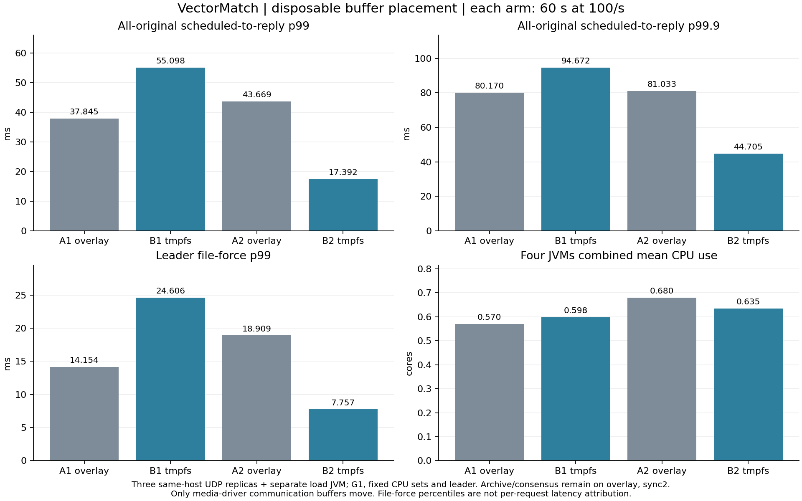

# Disposable communication-buffer placement: complete ABAB result

**The candidate does not meet the precommitted adoption rule.** Moving only Aeron media-driver communication buffers from overlay storage to tmpfs makes the first pair slower and the second pair faster. Keep the production default unchanged. All six original runs are closed, audited and privately archived; none was replaced by a repeat.

One frozen artifact (`8a9bb125b627d4a05d80a1ff149f792c0b341d00`) runs on the existing CPU host: three UDP replica JVMs and a separate load JVM, disjoint fixed CPU sets, G1, 1–2 GiB heaps, fixed leader 0, explicit 1 ms maximum replica park and sync level 2. Each comparison schedules 6,000 one-lot IOC orders at 100/s for 60 seconds. A retains overlay-backed driver files; B selects experiment-owned tmpfs driver files. Archive recordings, catalogs, consensus state and snapshots remain on the original overlay filesystem.

|Original arm|Driver files|Accepted / planned|Full p50 ms|Full p99 ms|Full p99.9 ms|Maximum ms|Peak planned but unconfirmed|
|---|---|---:|---:|---:|---:|---:|---:|
|A1|overlay|6,000 / 6,000|8.259|37.845|80.170|103.283|11|
|B1|tmpfs|6,000 / 6,000|8.880|55.098|94.672|118.245|12|
|A2|overlay|6,000 / 6,000|8.436|43.669|81.033|101.032|11|
|B2|tmpfs|6,000 / 6,000|8.073|17.392|44.705|62.341|7|

The full percentiles include every original planned arrival through its reply. All four arms have zero not-sent, rejected or unknown outcomes and no release more than 20 ms late. B1 confirms 5,999 orders before the arrival deadline and the final order during drain; the other arms confirm all 6,000 inside the window. No slow reply is excluded.

B1/A1 p99 is 1.456; B2/A2 is 0.398. B2 passes this finite window's absolute latency gate, but B1 fails both the required paired p99 improvement and non-regressing p99.9. The registered rule requires both pairs to pass, so **the candidate is not promoted and no candidate 30-minute run is launched**. The preceding baseline [30-minute run](REPLICATED_PATH_PROBE_RESULTS.md) is already complete; its failed gates remain reported separately. A favorable one-minute B2 is not sustained performance evidence.

## What the measurements isolate

|Original arm|Leader callback p99 µs|Leader file-force p99 ms|Four JVMs combined mean CPU cores|
|---|---:|---:|---:|
|A1|75.829|14.154|0.570|
|B1|155.838|24.606|0.598|
|A2|102.829|18.909|0.680|
|B2|105.048|7.757|0.635|

File-force tails move in the same direction as end-to-end tails in both pairs, while business callbacks remain much shorter. That is an association, not per-request causal attribution or proof that physical storage alone is responsible. File-force duration includes OS descheduling; GC, shared-host activity and I/O contention also remain relevant. One GC pause is observed in each JVM per finite arm, with maxima between 6.126 and 17.453 ms. The result does not establish a repeatable benefit from communication-buffer placement on this host.

Actual `/proc/PID/maps` records prove all four A JVMs map their driver files on device 48 and all four B JVMs map them on tmpfs device 140. Every replica's durable archive directory remains on device 48. The source and post-window observer select the same experiment-owned driver policy. This is actual path/device verification, not a claim that overlay storage survives provider or power failure.



## Correctness, provenance and closure

Both two-second functional qualifications accept all 20 originals. The four comparison arms produce byte-identical final canonical states, SHA-256 `602ffc6d073adb720c0110a518b4b3f8749959df212442a2d4c6a6e01faa4195`. Every replica executes all original callbacks. Final replay and account invariants pass. Replay uses the same matching implementation; a separate Python decoder checks each original command/reply and the fixed fixture's sequence/result arithmetic. This is not an independent full matching-algorithm implementation.

The local cluster suite passes **524 tests, zero failures/errors/skips**. Both native Linux configurations also pass their functional qualification. Each raw archive contains original source rows and wire frames, worker callbacks, final states, GC/JFR events, process metrics, runtime identity and process closure. Member hashes and full authenticated archive downloads are verified before retiring only duplicate local/remote bulk files.

Two operational interruptions are preserved in the [closure amendments](../evidence/2026-10-27/replicated-buffer-layout-r1/closure-amendment/):

- The first qualification's metadata collector used `node0/archive` instead of `node-0/archive`. It failed before producing a host record or audit manifest. The corrected collector audits the unchanged original run; pre-amendment original hashes were checked before continuation.
- The final B2 source naturally exits successfully at 11:00:42 UTC. A later SSH timeout prevents replica closure; connectivity recovery permits closure at 11:11:20–21 UTC. The original request window and source tape are retained. Telemetry calculations are restricted to that original window; no workload is rerun. Both the timeout and the resumed closure are archived.

The [verified summary](../evidence/2026-10-27/replicated-buffer-layout-r1/SUMMARY.json) checks every original arm, actual launch/exit chronology, fixed candidate/configuration, mapped devices, cross-arm final-state hashes and the selection decision. Reproduce the summary and figure with:

```sh
python3 scripts/summarize-replicated-buffer-layout.py evidence/2026-10-27/replicated-buffer-layout-r1 --output /tmp/layout-summary.json
python3 scripts/plot-replicated-buffer-layout.py /tmp/layout-summary.json /tmp/layout-figures
```

Raw archives remain in the private draft release; each arm's `PRIVATE_ASSET_VERIFIED.json` records its asset ID, bytes and SHA-256. The [post-campaign check](../evidence/2026-10-27/replicated-buffer-layout-r1/POST_CAMPAIGN.json) verifies all 68 JVM launches across this six-arm campaign and the preceding eleven-arm campaign have exited, no Java process remains, and the owned tmpfs roots are removed. The existing CPU host remains available; no new cloud resource was created.

See the [frozen protocol](REPLICATED_BUFFER_LAYOUT_PROTOCOL.md) for the decision rule. This is a bounded synthetic IOC fixture on one physical host, with a memory-only source tape during arrivals. It does not prove independent failure domains, 100K/s replicated capacity, hard realtime, production readiness or true-money trading.
