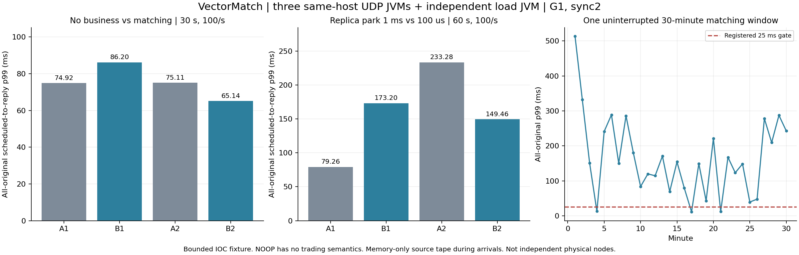

# Replicated path decomposition and idle-policy comparison

**The empty-service control retains large tails; shortening the replica park does not pass both paired criteria.** All eleven native arms are closed and archived. The selected 1 ms policy completes all 180,000 originals in one 30-minute run, but its 202.051 ms p99 fails the registered latency gate. This is a diagnostic negative result, not a low-latency performance win.

All runs use the same existing CPU host, three actual Aeron UDP replicas and one load JVM, G1, disjoint CPU affinity, leader 0 and sync level 2. These are bounded single-lot IOC fixtures. Source samples are memory-only during arrivals and serialized afterward; R3 used a different durable source recorder and producer/cache population, so these are not a direct before/after against R3.

|Arm|Service|Planned|Accepted|p50 ms|p99 ms|p99.9 ms|Source releases >20 ms|
|---|---|---:|---:|---:|---:|---:|---:|
|path-a1|NOOP|3000|3000|9.259|74.922|175.520|0|
|path-b1|MATCHING|3000|3000|9.411|86.200|127.656|0|
|path-a2|NOOP|3000|3000|14.395|75.113|98.251|0|
|path-b2|MATCHING|3000|3000|9.453|65.137|125.456|0|
|idle-a1|MATCHING|6000|6000|9.241|79.261|127.710|0|
|idle-b1|MATCHING|6000|6000|9.751|173.200|245.039|0|
|idle-a2|MATCHING|6000|6000|34.043|233.276|512.738|0|
|idle-b2|MATCHING|6000|6000|5.611|149.460|236.525|0|

Path A/B compares NOOP with MATCHING for 30 seconds at 100/s, all at explicit 1 ms replica max park. NOOP echoes a same-length successful response with zero business-state sentinels; it does not trade. Idle A/B compares explicit 1 ms with 100 µs for 60 seconds at 100/s, all MATCHING. The source is unchanged. B's p99 is worse in the first pair and better in the second; the precommitted rule retains 1 ms for the long run. Both paired directions, CPU costs and all failed latency gates remain in the raw audits.

The empty-service callback p99 on the leader is 27.460/36.370 µs, while its full p99 is 74.922/75.113 ms. Replica GC pauses are absent in the first empty and matching comparison. File-force calls show long stalls. This supports investigating replication/storage/scheduling ahead of matching logic; marginal percentiles are not additive, and file-force duration includes any OS descheduling during the call. These observations do not prove one exclusive physical-storage cause.

## Uninterrupted 30-minute matching result

|Metric|Observed|
|---|---:|
|Scheduled rate / duration|100 orders/s / 1,800 s|
|Planned / accepted|180,000 / 180,000|
|Not sent / rejected / unknown|0 / 0 / 0|
|Confirmed before the arrival deadline|179,999|
|All-original p50 / p99 / p99.9|8.848 / 202.051 / 402.291 ms|
|Maximum scheduled-to-reply|1,080.175 ms|
|Peak scheduled but not confirmed / remaining after drain|109 / 0|
|Source releases more than 20 ms late|8; maximum 42.203 ms|
|One-minute windows meeting p99 ≤25 ms|3 of 30|
|Final matching state and account invariants|Pass|

All 180,000 original callbacks appear on each replica. The leader callback p99 is 43.419 µs, whereas its file-force p99 is 55.598 ms and maximum is 768.775 ms. Across replicas, file-force maxima are 768.775–785.863 ms; there are eight GC pauses per replica, with maxima 23.061–33.058 ms. Mean CPU consumption is 0.157/0.104/0.109 cores for the replicas and 0.075 cores for the source, measured from enclosing process samples. Low average CPU use does not exclude scheduling stalls. The source's offer-to-reply p99 is 202.036 ms: almost the full scheduled-to-reply p99 remains after submission.

The run passes complete acceptance, no unknown, fixed leader, in-window completion and final-state checks. It fails source timing, global p99, p99.9 and the every-minute p99 gate. The single final reply after the arrival deadline is counted; no slow original is removed. The eight late source releases are also retained, so this does not certify a clean open-loop SLA even though most of the measured tail is downstream of submission.

The [verified summary](../evidence/2026-10-27/replicated-path-probe-r2/SUMMARY.json) binds all eleven original arms to their runtime, CPU placement, actual launch/exit chronology and private raw-archive receipts. Rebuild it with `python3 scripts/summarize-replicated-path-probe.py evidence/2026-10-27/replicated-path-probe-r2 --output /tmp/path-summary.json`; the plot script consumes that summary. Raw long-run asset `681296307` contains 54,804,147 bytes and has SHA-256 `0b0b046f4dcb572f922e193828edb57d320049143fd08aa4b3eaded1ea2e73c1`.

The pinned [Aeron 1.53.3 RecordingWriter](https://github.com/aeron-io/aeron/blob/1.53.3/aeron-archive/src/main/java/io/aeron/archive/RecordingWriter.java) forces file content and metadata at sync2 before advancing its recording position. Durability is not disabled to improve this benchmark. A separate [disposable-buffer placement protocol](REPLICATED_BUFFER_LAYOUT_PROTOCOL.md) tests relocating only reconstructible communication buffers to tmpfs; its new runtime is not used by this frozen path-probe campaign.

The first R1 native qualification is preserved as a measurement-audit failure: the short-lived source exited before a final enclosing CPU sample. R2 adds a two-second post-window polling tail without changing original request times. All R2 original frames, source rows, worker timings, final states, telemetry and closures are member-hashed, privately uploaded and fully downloaded for verification before duplicate retirement. Matching final-state replay uses the same core implementation; Python independently checks the original wire fields and this fixed fixture's sequence/result arithmetic.

See the [frozen protocol](REPLICATED_PATH_PROBE_PROTOCOL.md) and [all thin receipts](../evidence/2026-10-27/replicated-path-probe-r2/). Same-host scope does not establish physical fault isolation, media power-loss durability, continuous outbox export, high-rate replicated capacity or production readiness.
