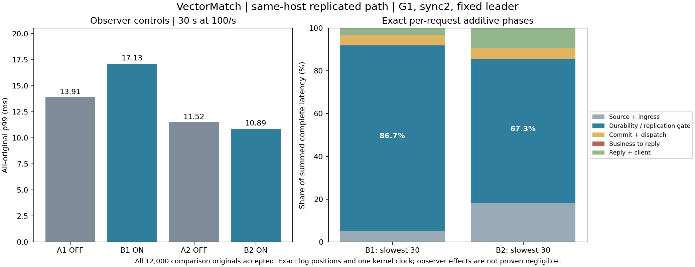

# Exact request-stage attribution on the existing CPU host

**Every original in both traced comparison arms joins to its exact log block and commit gate.** Among each arm's slowest 1% of originals, durability/replication waiting accounts for 86.7% and 67.3% of total latency. Actual critical-path file-force calls account for 48.1% and 34.4%. These are sums of per-request intervals, not differences between marginal percentiles.

All six original arms use source candidate `72f0bc01beb1386fdc38273457ef8671e8e2dbdd`, the same diagnostic Aeron overlay, common Linux monotonic clock, fixed leader/CPU sets/G1/heap, 1 ms park, overlay storage and sync2. Four comparisons run at 100/s for 30 seconds; two 10/s, two-second functional qualifications precede them. All 12,040 originals confirm, with zero not-sent/rejected/unknown and correct final canonical states. The four comparison states are byte-identical.

|Arm|Trace|Accepted|p50 ms|p99 ms|p99.9 ms|Combined mean CPU cores|
|---|---|---:|---:|---:|---:|---:|
|A1|OFF|3,000|8.071|13.913|34.129|0.641|
|B1|ON|3,000|8.284|17.132|47.719|0.663|
|A2|OFF|3,000|8.095|11.517|29.568|0.660|
|B2|ON|3,000|8.045|10.888|13.941|0.660|

Observer-effect directions disagree: ON/OFF p99 ratios are 1.231 and 0.945. The first traced arm is materially slower; this is not proof of negligible observer overhead or a performance improvement. These short windows also do not replace the preceding failed 30-minute latency result.



## Where the slow originals spend time

Each column uses that arm's slowest 30 originals and divides the summed phase duration by their summed complete latency. It does not average percentiles or discard any original from the full-stream distribution.

|Phase share of slowest-original latency|B1|B2|
|---|---:|---:|
|Source scheduling and queueing|0.09%|0.38%|
|Ingress delivery and processing|5.18%|17.79%|
|Durability / replication gate|86.67%|67.28%|
|Commit processing after gate + service dispatch|4.65%|5.10%|
|Business execution through reply offer|0.08%|0.26%|
|Reply delivery and client finalization|3.32%|9.18%|

The gate is the later of the leader's local recorded position and the earliest qualifying follower acknowledgement at the leader. It is a follower branch for 2,781/3,000 requests in B1 and 2,930/3,000 in B2. The first qualifying follower can differ per original. The trace does not assume that a faster follower lets the leader bypass its own recording.

|Critical gate component, as share of the same full tail|B1|B2|
|---|---:|---:|
|Archive delivery / polling wait|34.49%|12.99%|
|File write|0.06%|0.09%|
|File force|48.11%|34.38%|
|Acknowledgement delivery after recorded-position publication|4.01%|19.82%|

In B1, 95.7% of the archive-wait interval overlaps earlier force calls in that same log recording; this overlap represents 33.0% of the full slow-tail latency. In B2, the corresponding fractions are 3.2% and 0.4%. Long synchronization calls therefore coincide with substantial queueing in the stalled sample, while the quieter sample exposes more transport/polling overhead. An overlap does not identify the packet's arrival instant, and file-force time includes OS descheduling. This identifies the software wait boundary; it is not proof of an exclusive physical-device cause.

The next hypothesis is startup recording-segment block allocation: existing segments are logically 128 MiB, and the pinned writer uses `RandomAccessFile.setLength`. Test whether allocating their disk blocks before arrivals reduces subsequent synchronization tails. This is a hypothesis to test, not a conclusion that sparse allocation caused the measured delays. Keep file bytes, logical lengths, state storage and sync2 unchanged; never use glibc's potentially zero-writing `posix_fallocate` fallback. The separate preallocation protocol freezes its own candidate and ABAB rule.

## Verification and reproduction

The [summary](../evidence/2026-10-27/replicated-stage-trace-r1/SUMMARY.json) verifies all six original archives, runtime/configuration, chronology, shared kernel-clock attestations, cross-arm state hashes and exact attribution completeness. Every traced original's additive phases sum to its original planned-to-confirmed latency. Actual class-origin logs prove the pinned patched classes ran. The bounded tapes report no lost events. All raw archives were privately uploaded, fully downloaded and member-hash verified. B1/B2 archives were also fully reverified before extracting the detailed offline attribution.

```sh
python3 scripts/summarize-replicated-stage-trace.py evidence/2026-10-27/replicated-stage-trace-r1 --output /tmp/stage-summary.json
python3 scripts/audit-replicated-stage-trace.py ORIGINAL_EXTRACTED_ARM --jfr /path/to/jdk/bin/jfr --output /tmp/stage-audit.json
python3 scripts/analyze-stage-recording-wait.py ORIGINAL_EXTRACTED_ARM --manifest ORIGINAL_EXTRACTED_ARM/ARCHIVE_MEMBER_MANIFEST.json --output /tmp/gate-analysis.json
```

For an extracted traced arm, remove only a derived `stage-attribution.csv` before rerunning attribution into that working copy; never alter the archived original. Its outer archive manifest retains the original derived file's hash. The base audit verifies original source rows, replies, worker callbacks, telemetry and canonical states. Replay uses the same matching implementation, with separate Python wire/sequence arithmetic checks.

Local qualification passed 526 Java tests and five attribution tests, including mismatched-clock, lost-event and wrong-log-position rejection. See the [frozen protocol](REPLICATED_STAGE_TRACE_PROTOCOL.md). These are same-host, finite synthetic IOC results with memory-only load-source evidence during arrivals; they do not establish high-rate replicated capacity, independent physical failure domains or production readiness.
