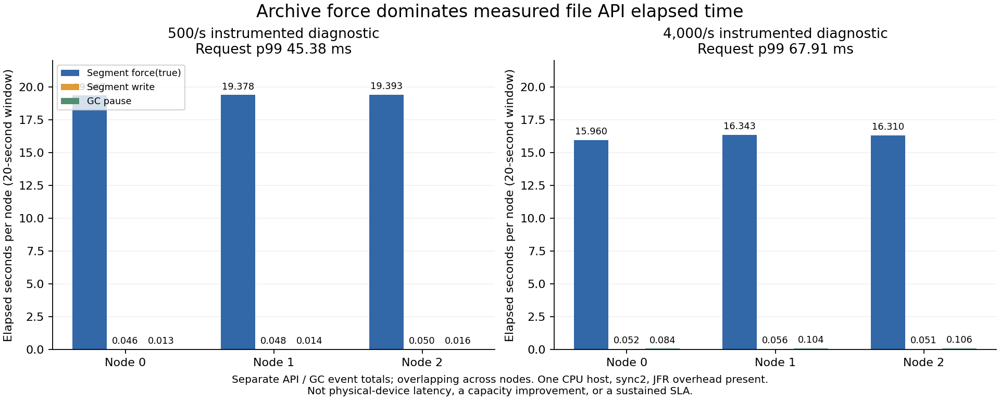

# Owned-node JFR: archive force is the first bottleneck to isolate

Both instrumented points passed the original financial/raw-order/replay audit and all three snapshot/cold restores. All planned orders were accepted;not-sent,reject and observed/final unknown counts are zero. These are diagnostics with profiling overhead,not an uninstrumented optimization comparison.

| Arrival rate/s | Accepted | In-window goodput/s | All-arrival p99 ms | Post-positive-offer p99 ms |
|---:|---:|---:|---:|---:|
| 500 | 10000/10000 | 499.85 | 45.375859 | 9.980306 |
| 4000 | 80000/80000 | 3993.45 | 67.905817 | 12.692245 |

Each point has20 seconds of independent arrivals,a fresh lineage,the same CI23-compiled artifact `c38e86a6`,fixed leader0,sync2,CONTINUE,CLOSED read banks,agent100us,owner1ms,batch4 with50us partial-batch eligibility,cut1536,read32/page32/chunk6144,127 active producers and ports22000. All three original JVMs run on one CPU host. No extra observer JVM runs during arrivals.

| Rate/s | Node | Segment force calls | Force elapsed s | Force p50 ms | Force p99 ms | Plain write elapsed s | GC pause total ms | GC pause max ms |
|---:|---:|---:|---:|---:|---:|---:|---:|---:|
| 500 | 0 | 6529 | 19.346881 | 2.719949 | 5.043142 | 0.046366 | 12.776723 | 4.688306 |
| 500 | 1 | 6484 | 19.378480 | 2.726199 | 5.011863 | 0.047556 | 14.302217 | 5.173691 |
| 500 | 2 | 6530 | 19.392539 | 2.714720 | 5.014513 | 0.049597 | 15.971768 | 5.537087 |
| 4000 | 0 | 5077 | 15.959762 | 2.920317 | 6.040091 | 0.051851 | 83.693936 | 7.889350 |
| 4000 | 1 | 4987 | 16.342679 | 3.072075 | 6.145410 | 0.056283 | 103.539401 | 7.327647 |
| 4000 | 2 | 4969 | 16.310275 | 3.056265 | 6.142640 | 0.050620 | 106.354446 | 9.071126 |

All rows above refer to the actual `node-N/archive/0-0.rec` path and archive-conductor thread. Every counted segment force event requests metadata (`force(true)`). Only events fully contained in the source arrival window enter this table;boundary-crossing events remain in the complete analysis. Node elapsed times overlap and must not be added into one host-time fraction. GC pause counts/times remain separate from concurrent GC cycle time.

The measured concentration prioritizes archive force over ordinary segment write or GC as the next experiment. It does not isolate the physical device,filesystem,overlay behavior or scheduling contribution. The filesystem observed on this CPU is `overlay`;the backing media and physical persistence guarantees have not been established. Sampled process CPU and allocation/execution samples are retained in the summaries;sampled allocation weights are not exact allocated-byte counts.

The pinned Aeron1.53.3 [RecordingWriter](https://raw.githubusercontent.com/aeron-io/aeron/1.53.3/aeron-archive/src/main/java/io/aeron/archive/RecordingWriter.java) writes and performs the configured force before advancing its position. [RecordingSession](https://raw.githubusercontent.com/aeron-io/aeron/1.53.3/aeron-archive/src/main/java/io/aeron/archive/RecordingSession.java) publishes recording progress after that work. [ConsensusModuleAgent](https://raw.githubusercontent.com/aeron-io/aeron/1.53.3/aeron-cluster/src/main/java/io/aeron/cluster/ConsensusModuleAgent.java) binds log append progress to the archive recording-position counter and bounds leader commit by that progress. This source path supports the bottleneck hypothesis;it does not turn a JFR API duration into a physical-device durability certificate.

All seven owned process identities,birth times,explicit selected-event settings and profile files are verified. Parent and three original node observations bracket the whole arrival window;the three cold-recovery JVMs correctly start after it. No JFR DataLoss event was observed. Monotonic/UTC anchors are retained;midpoint offset drift is550ns at500/s and1040ns at4000/s,with anchor-read spans920/2180ns and1110/3910ns respectively. This does not establish per-request nanosecond causal alignment. No independent percentiles are subtracted or pooled.

Next isolate sparse versus fully materialized pre-sized files using a bounded standalone force(true) A/B/A/B on the same filesystem,before any backend change. It must retain every sample and verified readback. Keep sync2 and all native correctness gates;only a subsequent qualified native A/B/A/B can justify promotion. Do not overwrite active archive files or precreate future rollover files. Neither10ms global p99,hard realtime,HFT suitability,physical-host fault isolation nor continuous100M has been proven.

[Prospective protocol](V4_OWNED_JFR_PROTOCOL.md) · [Exact source/CI23/JAR qualification](../evidence/2026-10-26/runpod-cpu/v4-jfr-diagnostic-r1/linux-admission-r1/README.md) · [Summaries,full private verification and original-scope references](../evidence/2026-10-26/runpod-cpu/v4-jfr-diagnostic-r1/results-r1/README.md).

