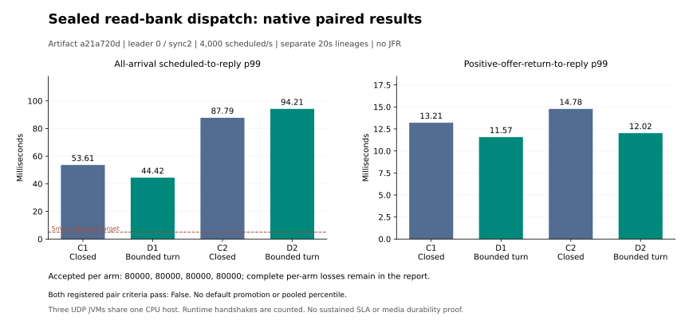

# Sealed direct-read dispatch: fixed-artifact native comparison

All four complete original correctness/replay/snapshot/cold-recovery audits pass. All four finite gates pass: **True**. Both registered paired optimization criteria pass: **False**. These finite repeats do not establish a sustained production SLA.

| Arm | Read-bank dispatch | Accepted | In-window goodput/s | All-arrival p99 ms | Post-offer p99 ms | Actual yield turns | Yield business admissions |
|---|---|---:|---:|---:|---:|---:|---:|
| C1 | CLOSED | 80000/80000 | 3993.45 | 53.609842 | 13.205838 | 0 | 0 |
| D1 | BOUNDED_TURN | 80000/80000 | 3993.65 | 44.423232 | 11.572537 | 260 | 20839 |
| C2 | CLOSED | 80000/80000 | 3993.45 | 87.793868 | 14.777101 | 0 | 0 |
| D2 | BOUNDED_TURN | 80000/80000 | 3993.90 | 94.214128 | 12.024905 | 260 | 19384 |

Artifact `a21a720ddfd479faf1129176bc2ff1adff2e34084874ca621999a4cdb4ffe3f3`,source `97db58e2`,qualified by full CI28. Both arms use DIRECT_UDP sealed history reads with identical enabled sidecars and descriptor handshakes. Leader0,sync2,CONTINUE file work,agent100us,owner1ms,batch4/50us,cut1536,read32/page32/chunk6144,127 active producers/Q64,ports22000 and20-second independent planned arrivals are fixed. No JFR or observer JVM runs during arrivals. These are three real UDP JVMs sharing one CPU host,with a fresh lineage for every arm.

Only CLOSED versus BOUNDED_TURN changes. A bounded turn permits at most127 original business commands after the previous read bank closes and drains;admitted business drains before the next bank opens. Actual independent audits bind those admissions,original deadlines,read credits,allowed publication/drain phases and pre-offer destructive intents to the source tapes. Business,PrepareArchive and ACKs retain the replicated sync2 path and forced/readback prefix receipts. Historical counters remain explicitly sealed.

Registered criterion:at least10% lower global all-arrival accepted p99,without worse post-positive-offer p99 or fewer in-window accepted orders;both finite gates and both pairs must pass. Exact integer nanoseconds and counts decide. Global p99 is undefined if a planned arrival lacks a confirmed accepted outcome. Do not pool percentiles,discard startup requests or substitute conditional latency.

`{"bothFiniteGates": true, "candidate": "d1", "control": "c1", "globalP99AtLeastTenPercentBetter": true, "inWindowAcceptedNoRegression": true, "postOfferP99NoRegression": true, "registeredCriterionPassed": true}`
`{"bothFiniteGates": true, "candidate": "d2", "control": "c2", "globalP99AtLeastTenPercentBetter": false, "inWindowAcceptedNoRegression": true, "postOfferP99NoRegression": true, "registeredCriterionPassed": false}`

Preceding500/s BOUNDED_TURN qualification accepted10000 synthetic orders;goodput499.85/s;globalp9929.214346ms;zero unknown/notSent. It passed full financial/replay/snapshot/cold recovery and actual bounded-turn audits,and is excluded from the4000/s cohorts.

CI28 passes556 Java/209 Python tests,including11 real PostgreSQL tests,zero failures/errors/skips. Both actual CLOSED and BOUNDED_TURN capacity protocols independently replay10000 orders and complete three snapshots/cold restores. CI timing is not a performance benchmark. All308 application classes match actual CI output;454 JDK file bodies and59 observed Linux class origins match staged inputs.

All original arrivals,requests,actual offers,replies,trade/event prefixes,frame ledgers,receipts,snapshots and cold restores remain in immutable same-private-repository draft attachments and full member manifests. Every attachment is fully authenticated-downloaded and all original hashes,sizes,modes,owners and directories verified before progression. APFS clone packaging only reduces local duplicate space;it does not change any raw body.

The preceding sealed route comparison uses a different artifact and single factor;its results remain separate. Two20-second repeats do not establish statistical significance,long-run stability,independent physical-host fault isolation,physical media durability,hard realtime,HFT endorsement,continuous100M or funded external trading. Default remains CLOSED. The<=5ms all-arrivalp99 production target requires its separate ten-minute workload and repeats.

[Prospective protocol](V4_SEALED_BOUNDED_DISPATCH_PROTOCOL.md) · [CI28/full original qualification](../evidence/2026-10-26/runpod-cpu/v4-sealed-bounded-dispatch-r1/linux-admission-r1/README.md) · [Complete derivation and private proofs](../evidence/2026-10-26/runpod-cpu/v4-sealed-bounded-dispatch-r1/comparison-r1/README.md).

## Original-arrival tail decomposition

All80000 original rows per arm are rechecked against the full archive and exact member hashes. Every planned second contains4000 rows;nearest-rank globalp99 equals the independent audit. For each arm,the worst800 original requests define a diagnostic tail set. Fractions below use summed per-request latency components;percentiles are never added.

| Arm | Tail latency before actual dispatch | Scheduled seconds containing the worst800 requests |
|---|---:|---|
| C1 | 89.06% | 0:748, 18:6, 6:13, 9:33 |
| D1 | 82.03% | 0:797, 11:2, 3:1 |
| C2 | 91.79% | 0:800 |
| D2 | 92.71% | 0:800 |

Caller-observed phase overlaps are retained for every tail waiting interval. Their sums count concurrent waiting requests separately and are not elapsed wall time. These measurements identify waiting intervals;they do not isolate GC,network,filesystem or scheduler causality. Earlier source/route cohorts remain unchanged and separate. The existing owned-node JFR work suggests archive force remains an important next path to isolate;those instrumented older-artifact results do not establish the cause of this experiment.
