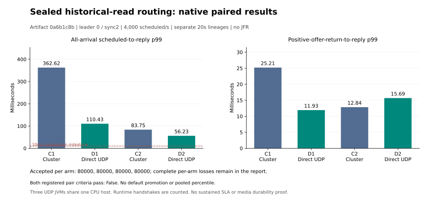

# Sealed historical-read export: fixed-artifact native comparison

All four original native correctness/replay/snapshot/cold-recovery audits pass. All four finite gates pass: **True**. Both registered paired optimization criteria pass: **False**. Neither a finite gate nor this comparison establishes a production SLA.

| Arm | Historical read route | Accepted | In-window goodput/s | All-arrival p99 ms | Post-offer p99 ms |
|---|---|---:|---:|---:|---:|
| C1 | CLUSTER | 80000/80000 | 3993.45 | 362.615475 | 25.210341 |
| D1 | DIRECT_UDP | 80000/80000 | 3993.45 | 110.431125 | 11.929653 |
| C2 | CLUSTER | 80000/80000 | 3993.45 | 83.754352 | 12.843972 |
| D2 | DIRECT_UDP | 80000/80000 | 3993.45 | 56.231503 | 15.690740 |

Artifact `0a6b1c8b51da763ec758cc7c65a4e07025ed180717d0d07951c2d36bce3e00f5`,source `f99d3843`,qualified by full CPU CI27. Leader0,sync2,CONTINUE,CLOSED read banks,agent100us,owner1ms,batch4/50us,cut1536,read32/page32/chunk6144,127 active producers/128 allocated slots,Q64,ports22000,and20-second independent arrival clock are fixed. No JFR or observer JVM runs during arrivals. Three actual UDP node JVMs share one physical CPU host;each arm starts a fresh finite business lineage. Earlier artifacts and workloads remain separate.

Both arms enable identical sealed sidecars and logged PrepareArchive descriptor/HELLO/WELCOME handshakes. Only ArchiveChunk/FetchEvents take the experimental DIRECT_UDP route. Business,PrepareArchive and destructive archive/event ACKs remain on AeronCluster with the documented forced/readback prefix receipts. Direct replies use sealed historical counters;ingress and ordinary publication positions never claim consensus commit positions.

Registered criterion:each candidate must reduce global all-arrival accepted p99 by at least10%,without worse post-positive-offer p99 or fewer in-window accepted orders;both finite gates and both pairs must pass. Exact integer nanoseconds and counts determine the result. Global p99 is undefined if any planned arrival lacks a confirmed accepted outcome;conditional percentiles never replace it. Two finite repeats do not establish statistical significance or default promotion.

`{"bothFiniteGates": true, "candidate": "d1", "control": "c1", "globalP99AtLeastTenPercentBetter": true, "inWindowAcceptedNoRegression": true, "postOfferP99NoRegression": true, "registeredCriterionPassed": true}`
`{"bothFiniteGates": true, "candidate": "d2", "control": "c2", "globalP99AtLeastTenPercentBetter": true, "inWindowAcceptedNoRegression": true, "postOfferP99NoRegression": false, "registeredCriterionPassed": false}`

Preceding500/s qualification:10000 accepted synthetic orders,zero unknown/notSent,goodput499.8/s,all-arrivalp9943.546721ms. Complete physical-order replay,three snapshots and cold restores agree. This qualification is excluded from the4000/s comparison cohorts.

The earlier source78a500/s qualification failed at terminal mixed-channel callback validation before financial replay/snapshot/cold recovery. Its complete failed original remains separately archived and unqualified. The new source changes post-load verification only. A new real full capacity-protocol CI regression verifies the fix;CI timing is not performance evidence. A local branch-reference refusal occurred before any remote launch intent;its original script and corrected branch reference are retained.

Every original arrival,request,actual offer code,reply,trade/event prefix,forced/readback receipt,control intent,original frame ledger,all six owned node lifetimes,snapshot and cold-restore record is retained in same-private-repository draft attachments. Each asset was fully authenticated-downloaded and every original body,size,mode,owner and empty directory verified before progression. Java replay uses the same adapter;the independent Python audit provides separate identity,accounting and trace reconciliation,not a separately implemented matching algorithm.

The filesystem is overlay;physical-media durability and independent-host fault isolation remain unverified. The<=5ms all-arrivalp99 production target requires a separate sustained ten-minute workload and repeats. No hard realtime,HFT endorsement,continuous100M,100M/s,100M physical connections or funded external trading is established here.

[Prospective protocol](V4_SEALED_READ_EXPORT_PROTOCOL.md) · [Complete CI27/source/JDK/Linux qualification](../evidence/2026-10-26/runpod-cpu/v4-sealed-egress-export-r1/linux-admission-r1/README.md) · [Original private comparison proofs](../evidence/2026-10-26/runpod-cpu/v4-sealed-egress-export-r1/comparison-r1/README.md).

## Original-request tail decomposition

All80000 original arrival rows per arm are rechecked against their full archive and member SHA-256. Each planned second contains4000 rows,and the recomputed nearest-rank globalp99 equals the original independent audit. For each arm,the worst800 original requests define a diagnostic tail set. The following fractions use summed per-request component durations within that set;they are not additive percentiles or a separate latency distribution.

| Arm | Tail latency before actual dispatch | Scheduled seconds containing the worst800 requests |
|---|---:|---|
| C1 | 94.34% | 14:800 |
| D1 | 93.25% | 0:800 |
| C2 | 91.17% | 0:661, 19:4, 2:11, 3:50, 7:74 |
| D2 | 86.64% | 0:460, 8:340 |

These are original scheduled-to-dispatch waiting intervals,not proof of a network,GC or scheduler cause. Caller-observed maintenance-phase overlaps are retained per request;their sums count concurrent waiting requests separately and are not wall time. In C1,the worst800 requests all originate in second14;D1 concentrates in second0. This variation prevents treating one unusually slow control as a stable baseline. The next experiment must isolate dispatch gating under sealed reads while preserving bounded admission,replicated business operations and complete replay/recovery evidence.

The final raw-asset re-download initially exhausted local disk. Four byte-identical generated packaging copies were removed only after proving equality to retained complete local closure archives and authenticated private assets. Original raw bodies remain in the closure archives and same-private-repository attachments. Only the same read-only D2 asset download resumed;no native workload,order or upload was repeated. The initial partial-download hash and all recovery refusals are retained in the comparison provenance.
