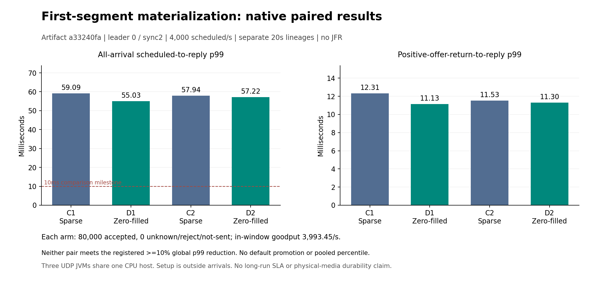

# First-segment preparation: native fixed-configuration comparison

All four financial/replay/snapshot/cold-recovery checks passed. All finite gates passed: **True**. Both registered paired optimization criteria passed: **False**. Both candidates meet10ms global p99: **False**. These two finite repeats do not establish a long-term latency guarantee or default promotion.

| Arm | First segment | Accepted | In-window goodput/s | All-arrival p99 ms | Post-positive-offer p99 ms |
|---|---|---:|---:|---:|---:|
| C1 | SPARSE_FIRST_SEGMENT | 80000/80000 | 3993.45 | 59.093696 | 12.310150 |
| D1 | ZERO_FIRST_SEGMENT | 80000/80000 | 3993.45 | 55.029076 | 11.129354 |
| C2 | SPARSE_FIRST_SEGMENT | 80000/80000 | 3993.45 | 57.943741 | 11.527069 |
| D2 | ZERO_FIRST_SEGMENT | 80000/80000 | 3993.45 | 57.219751 | 11.298921 |

The same CI24-compiled artifact `a33240fa` is used in all arms. Leader0,sync2,CONTINUE,CLOSED read banks,agent100us,owner1ms,batch4/50us,cut1536,read32/page32/chunk6144,127 active producers/128 slots,Q64,ports22000 and20-second independent arrivals are fixed. Only SPARSE_FIRST_SEGMENT versus ZERO_FIRST_SEGMENT changes. No JFR or extra observer JVM runs during arrivals. These are three real UDP JVMs on one CPU host,with a fresh lineage per arm. Earlier artifacts and the instrumented JFR results remain separate.

Each candidate must lower global all-arrival accepted p99 by at least10%,without worse post-positive-offer p99 or lower in-window accepted count;both arms must pass the finite gate,and both pairs must pass. Integer nanoseconds and exact counts determine the result. Global p99 is undefined if a planned arrival lacks an accepted outcome. Conditional percentiles never substitute for it.

`{"bothFiniteGates": true, "candidate": "d1", "control": "c1", "globalP99AtLeastTenPercentBetter": false, "inWindowAcceptedNoRegression": true, "postOfferP99NoRegression": true, "registeredCriterionPassed": false}`

`{"bothFiniteGates": true, "candidate": "d2", "control": "c2", "globalP99AtLeastTenPercentBetter": false, "inWindowAcceptedNoRegression": true, "postOfferP99NoRegression": true, "registeredCriterionPassed": false}`

All four complete raw assets were authenticated-downloaded and every original body,mode,owner and empty directory verified. Original arrival/request/reply tapes,trade/event prefixes,forced/readback receipts,control intents,full canonical replay,three actual snapshots and three cold restores remain retained. Independent mode proof binds parent argv,registration,configuration,summary,all three exact node identities and completed receipts,and all six original/cold owned process startup logs. Original startup reports fresh preparation;cold startup reports receipt reuse. The proof does not independently certify physical block allocation or backing-media durability.

The preceding ZERO_FIRST_SEGMENT native500/s qualification accepted10000 unique synthetic trades,goodput499.9/s,globalp9947.732736ms,with zero observed/final unknown and not-sent. This is functional qualification,excluded from the capacity cohorts.

The standalone file A/B/A/B showed11.8–21.2% lower force p99. That result screened this candidate;it is not itself a trading-latency gain. Native startup preparation completes outside arrivals. Only the first fresh128MiB segment is prepared;future rollover segments use original Aeron behavior. A completed marker binds the initial zero hash and exact identity;after business execution,the file contains replicated data and is never zeroed on cold recovery.

Transient GitHub TCP connection refusals occurred in post-upload/asset metadata GETs during qualification. The original upload completed once;only metadata/local publication resumed. The driver refused before starting4000/s until the complete private qualification proof existed. Subsequent evidence helpers use at most3 attempts for transient read-only metadata GETs,with original failures retained. Uploads and native workloads are not automatically repeated. All actual26-input runtime freezes and paired criteria remained unchanged.

The filesystem is overlay on one host;physical media and fault isolation are unverified. Two20-second repeats establish neither statistical significance,long-run stability,hard realtime,HFT endorsement nor continuous100M. The initial<=5ms globalp99 production target and external funded trading remain separate acceptance gates.

[Prospective protocol](V4_SEGMENT_PREPARATION_PROTOCOL.md) · [CI24/source/JDK/Linux qualification and complete raw asset references](../evidence/2026-10-26/runpod-cpu/v4-segment-preparation-r1/linux-admission-r1/README.md) · [Complete comparison derivation and original private proofs](../evidence/2026-10-26/runpod-cpu/v4-segment-preparation-r1/comparison-r1/README.md).

[SVG](../evidence/2026-10-26/runpod-cpu/v4-segment-preparation-r1/comparison-r1/figure/segment-preparation.svg). Every arm remains separate;no statistical interval is invented.
