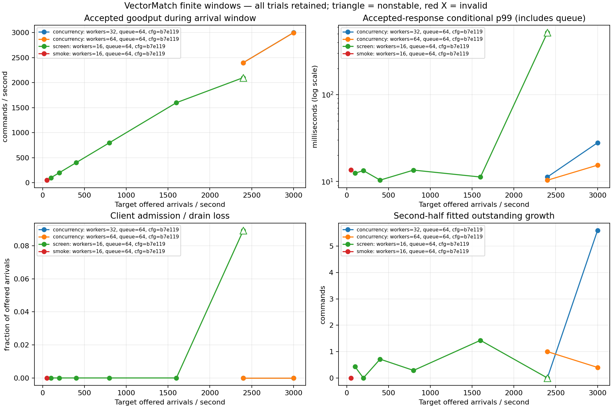

# Baseline capacity observations — 2026-10-23

The three-Pod replicated matching path accepted a fixed arrival rate of **3,000 commands/s for 10 seconds** with both 32 and 64 single-in-flight clients. Observed in-window goodput was **2,997.9/s** and **2,997.6/s** respectively. This establishes an observed finite-window lower bound; this baseline did **not** find the server throughput ceiling.

With 16 clients, 2,400 offered commands/s filled the client queues: 2,572 arrivals were never sent, accepted-response p99 reached 517.107 ms, and drain took 507.484 ms. Increasing clients to 32 or 64 restored all-arrival acceptance at that same rate. The 16-client failure therefore cannot be presented as a matching-engine ceiling. The workload, protocol, preparation, source, and node settings otherwise remained fixed.

All **11** completed trials remain in this report: 11 passed measurement/correctness validation, 10 met the declared finite-window stability thresholds, and one exposed overload or an undersized client window. There were **184,100 offered arrivals**, **181,528 confirmed accepted commands**, zero business rejections, zero server errors, zero initial unknowns, and zero final unresolved results. Each accepted measured command made one one-lot trade. Setup and 100 warm-up commands per trial are excluded from these measured totals.

## Every trial

Values are recomputed from [raw arrivals and backlog records](runs/) by the [analysis script](../../../scripts/analyze-capacity.py). Goodput counts accepted replies **inside the scheduled arrival window**; confirmations during drain do not increase it. Latency begins at each planned arrival, including scheduler lateness, FIFO queueing, and any retries. Percentiles use nearest rank.

| Run | Window s | Clients | Offered /s (total) | Window goodput /s | All-offered p99 ms | Accepted p99 ms | Client not sent | Rejects | Unknown initial/final | Peak queue | Drain ms | Observed window |
|---|---:|---:|---:|---:|---:|---:|---:|---:|---:|---:|---:|---|
| [smoke-0050-w16](runs/smoke-0050-w16/) | 10 | 16 | 50 (500) | 50.000 | 13.581 | 13.581 | 0 | 0 | 0/0 | 1 | 0.000 | Stable |
| [screen-0100-w16](runs/screen-0100-w16/) | 12 | 16 | 100 (1,200) | 100.000 | 12.450 | 12.450 | 0 | 0 | 0/0 | 1 | 0.000 | Stable |
| [screen-0200-w16](runs/screen-0200-w16/) | 12 | 16 | 200 (2,400) | 199.917 | 13.326 | 13.326 | 0 | 0 | 0/0 | 1 | 2.137 | Stable |
| [screen-0400-w16](runs/screen-0400-w16/) | 12 | 16 | 400 (4,800) | 399.750 | 10.352 | 10.352 | 0 | 0 | 0/0 | 1 | 6.999 | Stable |
| [screen-0800-w16](runs/screen-0800-w16/) | 12 | 16 | 800 (9,600) | 799.500 | 13.500 | 13.500 | 0 | 0 | 0/0 | 1 | 6.270 | Stable |
| [screen-1600-w16](runs/screen-1600-w16/) | 12 | 16 | 1,600 (19,200) | 1,599.000 | 11.242 | 11.242 | 0 | 0 | 0/0 | 1 | 8.547 | Stable |
| [screen-2400-w16](runs/screen-2400-w16/) | 12 | 16 | 2,400 (28,800) | 2,099.750 | — | 517.107 | 2,572 | 0 | 0/0 | 1,023 | 507.484 | Overload / undersized client |
| [concurrency-2400-w32](runs/concurrency-2400-w32/) | 12 | 32 | 2,400 (28,800) | 2,398.917 | 11.246 | 11.246 | 0 | 0 | 0/0 | 1 | 9.019 | Stable |
| [concurrency-2400-w64](runs/concurrency-2400-w64/) | 12 | 64 | 2,400 (28,800) | 2,398.250 | 10.323 | 10.323 | 0 | 0 | 0/0 | 1 | 9.886 | Stable |
| [concurrency-3000-w32](runs/concurrency-3000-w32/) | 10 | 32 | 3,000 (30,000) | 2,997.900 | 27.901 | 27.901 | 0 | 0 | 0/0 | 18 | 10.024 | Stable |
| [concurrency-3000-w64](runs/concurrency-3000-w64/) | 10 | 64 | 3,000 (30,000) | 2,997.600 | 15.393 | 15.393 | 0 | 0 | 0/0 | 1 | 9.213 | Stable |

“Client not sent” is client admission loss, not a server rejection. The all-offered accepted p99 is unavailable when any arrival is not accepted; the failed 16-client row's 517.107 ms is conditional on accepted replies. Peak queue is the observed sum of worker FIFO depths, excluding in-flight commands. Unknown columns retain the first timeout separately from final unresolved outcomes.

[Full-precision CSV](analysis/capacity.csv) · [Machine-readable analysis and checks](analysis/summary.json) · [SVG](analysis/capacity.svg)



## Fixed deployment and preparation

The [registered protocol](../../../docs/CAPACITY_CAMPAIGN.md), [campaign manifest](campaign.json), [deployment manifest](deployment.json), and [configuration verification](configuration-verification.json) identify this baseline. Each trial's configuration verification checks recorded supervisor arguments and its actual prepared snapshot digest; those checks are not independent provider or storage attestations.

| Identity | Value |
|---|---|
| Source/deployment revision | `9fd6f92f5d462bc383006896c7291359094e8645` |
| Deployment archive SHA-256 | `c78954abad1576b829189f2102c627d0af8bfa7567221d544b838af4bd31edbe` |
| Prepared core snapshot SHA-256, identical in all 11 trials | `294d3cc2ff167b78b7045553e744ff5377a0bac636d7cd4ac90f6bd599d6ccbf` |
| Comparison fingerprint | `b7e119bdc472aeb453235a0ffcb29ab47434027295d58bf78090fe55714ee867` |

All members used Aeron 1.53.3, Java 21.0.13, private UDP, Aeron MTU 1248 over interface MTU 1300, port base 23000, sync level 2, 1 GiB maximum node heap, SHARED media-driver/archive threading, default BackoffIdleStrategy, 131,072-byte send/receive socket buffers, outbox capacity 65,536, and a 128-session limit. Leader 0 was appointed using Aeron's test-only setting; every trial's official pre/post members output and sampled CnC role/term evidence passed with leadership term 0.

Every trial began with separate fresh state and the same fixed preparation: 64 buyer accounts funded with 300,000,000 quote units each, a seller with 60,000 base lots, one GTC ask at 10,000 ticks, and 100 one-lot warm-up IOC buys. Each measured command was an independent one-lot IOC buy. The original gateway/projector/PostgreSQL were paused during measurement; their capacity is outside this workload. No projector drained the trial outbox. The 30,000-arrival bound protects the 65,536-event outbox and 100,000 retained-order limit.

The generator used a 2 GiB maximum heap on **member 2's Pod**, an absolute monotonic fixed-arrival scheduler, round-robin queues of 64 per worker, one synchronous in-flight command per client, a 2-second request timeout, 30-second drain allowance, and a 20 ms scheduler-lateness invalidation threshold. Thus arrivals are independent of replies, while actual service concurrency is bounded by client count. A timeout retries the same identity before advancing that producer.

The [recorded topology](../runpod-network/summary.json) is three existing Runpod Secure Cloud Pods in EU-RO-1:

| Member | Pod ID | Private IPv4 | Visible CPU-quota upper bound | Visible memory upper bound |
|---|---|---|---:|---:|
| 0, fixed leader | `aykai4bhv4zdf9` | `10.0.212.169` | 5.1 CPU equivalents | 30,999,998,464 bytes |
| 1 | `9zt5cl1tpc7zt7` | `10.1.60.60` | 10.2 CPU equivalents | 30,999,998,464 bytes |
| 2, shared load generator | `h21wqh0s7g26bk` | `10.1.81.207` | 23.8 CPU equivalents | 61,999,996,928 bytes |

Quotas are visible upper bounds, not dedicated-core guarantees; host contention and hidden ancestors can impose tighter limits. Distinct Pods and observed host identities do not establish provider-certified physical anti-affinity. Storage is ephemeral container storage. Sync level 2 does not prove host power-loss durability. No additional Pods were created; the project's $20 total budget guard uses launch-time/rate estimates and excludes unrelated account workloads.

## Interpretation and limits

The declared stable-window rule requires valid correctness and fixed-leader evidence, at least 10 seconds, all arrivals accepted, no unknowns, at least 95% of target rate confirmed inside the window, drain at most `max(100 ms, 1% of window)`, and fitted second-half outstanding growth at most `max(2 commands, 1% of offered arrivals)`. Backlog uses non-atomic one-second queue-plus-in-flight observations; a full bounded queue can have a flat slope while dropping arrivals. Loss and drain checks still reject the 16-client 2,400/s trial. Small positive backlog drift is permitted by these finite-window thresholds.

Each point has one repetition and a 10–12 second arrival window. The observed 16-client interval is 1,600 stable versus 2,400 nonstable arrivals/s; its exact transition was not refined here. The 32/64-client paths remained stable at the highest tested rate, so **3,000/s is a tested arrival-rate lower bound, not a proven sustainable server maximum**. Higher client counts changing the result identifies a client-window/concurrency effect, not its unique CPU, storage, network, or batching cause. No statistical confidence interval, long-run tail bound, latency SLA, or unlimited-duration capacity follows from these trials.

Final checks replay confirmed commands in actual command-sequence order, compare canonical snapshot bytes, check invariants/assets and contiguous outbox accounting. The replay uses the same MatchingEngine implementation, supplemented by explicit balance/order/event arithmetic; it is not an independent matching algorithm. Raw per-arrival outcomes, trial receipts, process arguments, telemetry, CnC samples, and snapshots are retained in each run directory. CnC sampling cannot exclude every transition between samples; unchanged leadership terms and official pre/post views provide additional evidence.

Latency and arrival/drain durations use `System.nanoTime()` inside one generator JVM. UTC timestamps locate runs and telemetry; they do not establish synchronized-clock one-way latency. API execute-start is not the first wire-offer timestamp. This measures the direct client plus replicated matching path, excluding HTTP, SQL projection, and market-data fanout. Source identities, node settings, initial-state hashes, worker counts, queue sizes, and phases govern comparison groups.

The [extended profile](../runpod-capacity-extended/) has different seed funding/maker quantity, outbox capacity, and source/deployment identity. Its results must remain a separate configuration group and directory; do not splice them into this baseline's throughput curve.

## Recompute or repeat

From the repository root, recompute the archived analysis without contacting the cloud:

```sh
python3 -B scripts/analyze-capacity.py \
  --runs-dir evidence/2026-10-23/runpod-capacity/runs \
  --output-dir /tmp/vectormatch-baseline-recomputed \
  --campaign evidence/2026-10-23/runpod-capacity/campaign.json \
  --plot
```

To repeat a load point, first provision **fresh, isolated** three-member state using this pinned immutable release and the exact settings above; see the registered protocol and [archived orchestration record](reproduction/campaign.py). Do not point the trial at the original application's lineage. With Java 21 and the original private topology available on the generator's host:

```sh
export VECTOR_CLUSTER_HOSTS=10.0.212.169,10.1.60.60,10.1.81.207
export VECTOR_CLIENT_EGRESS_HOST=10.1.81.207
export VECTOR_AERON_MTU_LENGTH=1248
VM_RELEASE=/opt/vectormatch/releases/9fd6f92f5d462bc383006896c7291359094e8645
java --add-opens=java.base/jdk.internal.misc=ALL-UNNAMED \
  --add-opens=java.base/java.util.zip=ALL-UNNAMED -Xmx2g \
  -cp "$VM_RELEASE/dist/cluster/lib/*" \
  io.vectormatch.cluster.RemoteCapacityExperiment \
  /opt/vectormatch/evidence/FRESH-BASELINE-TRIAL \
  23000 3000 30000 64 64 2000 30000 0 20
```

Preserve each new trial's source/deployment and launch records, official pre/post member views, per-node telemetry/CnC files and all raw output. Run the fixed-leader/configuration checks before comparing it with the archived baseline; successful business replies alone do not verify a comparable deployment.
