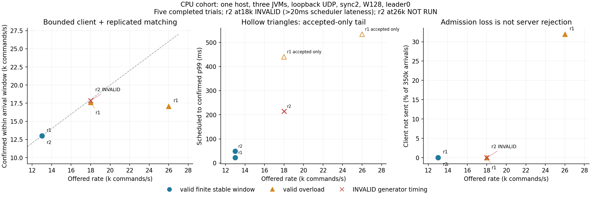

# CPU fixed-configuration capacity observations

Five of six preregistered points ran. Both13k/s finite windows passed;18k r1 and26k r1 were valid overload.18k r2 is INVALID due to scheduler lateness>20ms, and the controller correctly did not start26k r2. No trial is relabeled, retried or discarded. All attempted jobs have canonical validation, full archives and confirmed owned shutdown; initial/final unknown0.

|Offered/s|Rep|Valid|Finite stable|Window goodput/s|Not sent|All-arrival p99ms|Accepted-only p99ms|
|---:|---:|---|---|---:|---:|---:|---:|
|13000|1|True|True|12997.586|0|22.420911|22.420911|
|18000|1|True|False|17607.240|33|N/A|440.412489|
|26000|1|True|False|17076.949|111798|N/A|533.999613|
|13000|2|True|True|12997.177|0|48.816346|48.816346|
|18000|2|False|False|17856.669|0|N/A|214.330744 (invalid)|

Observed finite stable lower point is13k/s in both repetitions; valid overload is observed at18k/s. This brackets the tested deployed client+cluster path and is not a precise sustained-system ceiling or evidence of100M/s. W128 bounds the synchronous in-flight path. Each point has350k arrivals and fresh independent test state; reset epochs are not combined into a100M endurance claim.

All offered p99 is unavailable when any arrival is not sent; conditional accepted tails cannot replace it. The invalid18k r2 has350kaccepted and a raw214.330744ms tail, retained only as invalid diagnostics. Its scheduler failure stops the preregistered matrix; no synthetic recovery/replay was needed.

[Original matrix summary](../matrices/cpu-capacity-staircase-433-r1/matrix-summary.json), [verified stop closure](../matrices/cpu-capacity-staircase-433-r1/capacity-stopped-before-jmh.json), [original registration](../registrations/cpu-capacity-staircase-433-r1.json), and [plot input hashes](plot-inputs.json). Every complete trial lives under ../capacity/<job>/ with originalCSV gzip+SHA,canonical binaries,observer streams,configuration/leader/process evidence and independent31e4 analysis. Full native/IPC archives remain locally and in the authorized CPU archive mount. Old cloud materialized copies were manually removed only after archive/every-file verification; receipts retained.

Scope:SINGLE_HOST_THREE_JVM_LOOPBACK_UDP;source433,Temurin21.0.13+9,leader0,sync2,2GiB heaps,W128,queue64,mux1,park1ms,MTU1248,overlayfs,observer-on. It excludes HTTP/PostgreSQL/WS end-to-end delivery. No change of source/configuration between rates.
