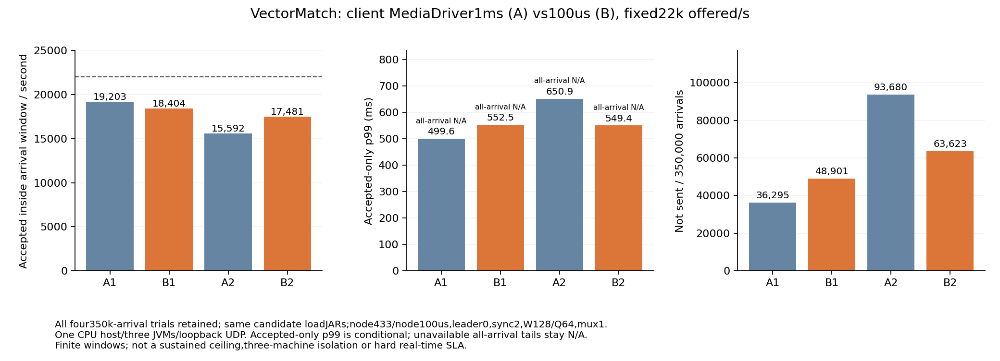

# Client-only MediaDriver max-park A/B/A/B

All four preregistered A1/B1/A2/B2 trials. Same candidate loadJARs in both arms;node433/node100us fixed;clientMediaDriver1ms(A)/100us(B),owner loop1ms fixed;leader0,sync2,2gheaps,W128/Q64,mux1,MTU1248,22k/s×350k fresh arrivals per independent state. One existing CPU host,threeJVMs,loopbackUDP. Window goodput excludes drain. Accepted-only tails are conditional;all-offered accepted p99 stays unavailable with any loss. CPU means use approximate window samples per owned process;host/cgroup is shared and counted once. No sustained ceiling,three-machine isolation,HTTP/PG/WS,100M or hard real-time proof.

|Stage|Client max park|Window accepted/s|Not sent|Accepted-only p99 ms|All-arrival p99 ms|Drain ms|Finite stable|
|---|---:|---:|---:|---:|---:|---:|---|
|A1|1000us|19203.297|36295|499.642|N/A|427.922|False|
|B1|100us|18404.446|48901|552.531|N/A|546.497|False|
|A2|1000us|15591.589|93680|650.856|N/A|513.019|False|
|B2|100us|17481.451|63623|549.384|N/A|470.362|False|

All original raw outcomes,actual measured-owner driver observations,source/classpath receipts,canonical/native archives and CPU samples remain bound in comparison.json. Older source433 capacity timings are context,not controls in this experiment. Both repetitions must be evaluated;two pairs do not establish a production SLA or a unique cause outside the explicitly changed driver policy.

[Numeric evidence and hashes](comparison.json)

[Decision: no promotion; paired directions disagree](INTERPRETATION.md)
