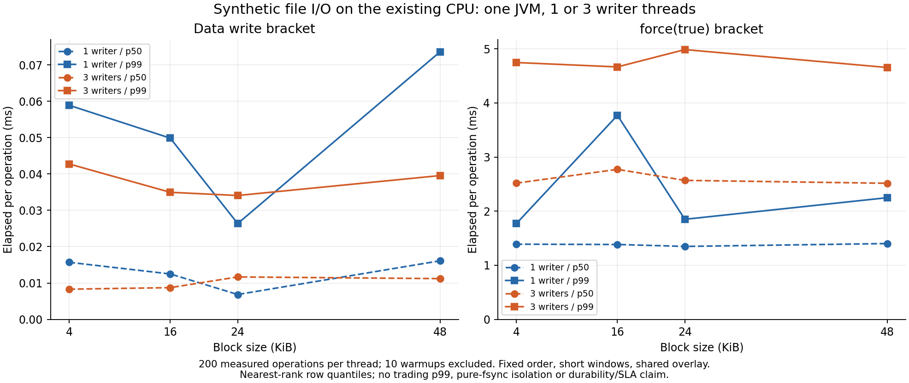

# Exploratory force(true) file-path observations

Exploratory singlehost overlay FileChannel circular-write+force(true),oneJVM with1/3writer threads. Perpoint200rows/thread. Fixed order and short windows do not control host/JIT/filesystem drift. Pooledwithinpoint quantiles are row distributions,not independent sampleconfidence or trading/SLA/uniquebottleneck/purefsync/durability proof. Preallocation/warmup raw retained but excluded from all measurement quantiles. No quantile pooling across different points.

|Writer threads|Block KiB|Measurement rows|Write p99 ms|Force p50 ms|Force p99 ms|Force max ms|Combined p99 ms|
|---:|---:|---:|---:|---:|---:|---:|---:|
|1|4|200|0.058909|1.389204|1.768240|2.210105|1.773290|
|1|16|200|0.049860|1.383644|3.770747|4.108634|3.790707|
|1|24|200|0.026360|1.347955|1.849169|2.300064|1.860889|
|1|48|200|0.073599|1.401054|2.248544|6.139250|2.261794|
|3|4|600|0.042760|2.517891|4.746567|7.101699|4.755497|
|3|16|600|0.034960|2.771808|4.665696|4.897454|4.673046|
|3|24|600|0.034079|2.568771|4.986044|10.012337|4.994294|
|3|48|600|0.039559|2.514772|4.654827|5.226181|4.666387|

All8points passed rawphase/byte/force conservation and dataSHA readback;3376force(true)calls include16preallocation+160warmup+3200measurement rows.85,164,032datawritebytes includeallphases. ActualLinuxoverlay options/classbytes before/after and exactPID/start/argv ownedstop receipts are retained. No service configuration was changed.

[Full numeric evidence and rawSHA](comparison.json)
