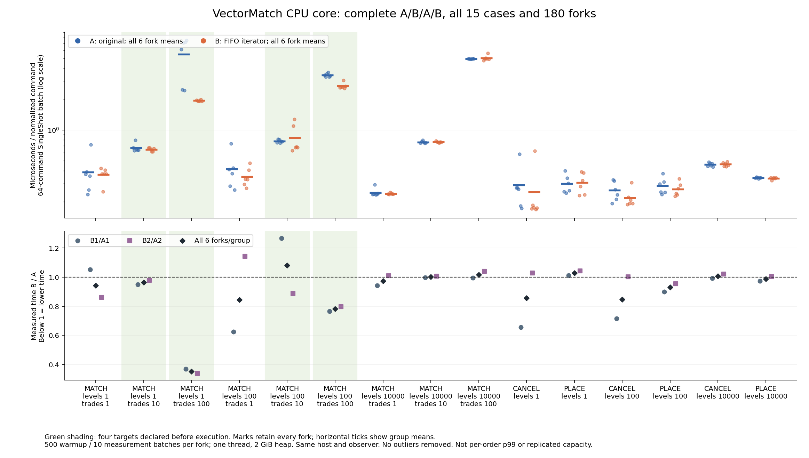

# Interpretation: partial mechanism benefit, no promotion

Evidence verification passed. The predeclared expectation that all four target cells improve in both pairs was not fully met:three cells have lower means in both pairs,one is inconsistent. The candidate remains on codex/core-level-iterator and is not deployed in the replicated capacity campaign.

|Initial levels|Maker trades/command|A mean us|B mean us|Pair1 B/A|Pair2 B/A|Both lower|
|---:|---:|---:|---:|---:|---:|---|
|1|10|0.670544|0.645535|0.948|0.978|True|
|1|100|5.473930|1.933905|0.368|0.339|True|
|100|10|0.777928|0.840541|1.267|0.888|False|
|100|100|3.433841|2.683192|0.766|0.797|True|

All15cases,all6fork means/group and both paired ratios appear in [comparison](comparison.json) and [figure](all-case-comparison.png);no outliers removed. At1level/100trades baselinefork means are bimodal and all retained;do not turn the large mean ratio into a universal guarantee. At100levels/10trades B1 regresses and B2 improves;combinedB/A1.080487 remains disclosed. PLACE/CANCEL and10000levelcontrols also retain mixed directions and regressions.

These SingleShot64-command batch means exclude networking,persistence,replication and allocation outside the measured batch. They do not supply single-order p99 or sustained throughput. The owned observer consumes19.05–24.99CPU seconds per roughly53.5s stage;the identical observer is enabled in bothgroups. No observer-off baseline is substituted.

