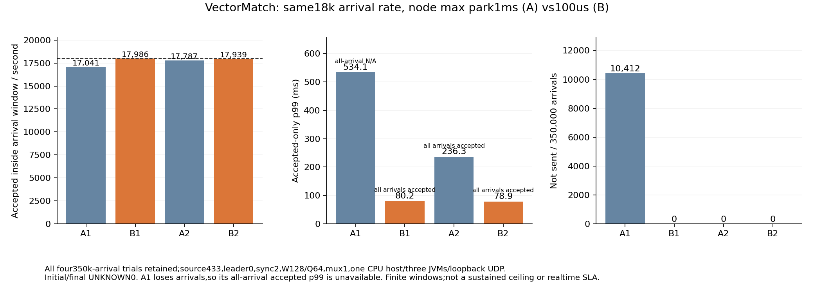

# Fixed18k node-only max-park A/B/A/B

All four registered trials passed canonical,asset,leader,configuration,actual idle-instance,raw-arrival and owned-stop/archive checks. Each uses350kfresh arrivals in separate test state. Node maximum park alone changes;the client scheduler/driver/owner remain fixed.

|Stage|Node max park|Window confirmed/s|Not sent|Accepted-only p99 ms|All-arrival accepted p99 ms|Drain ms|Finite stable|
|---|---:|---:|---:|---:|---:|---:|---|
|A1|1000us|17040.754|10412|534.113|N/A|471.312|False|
|B1|100us|17986.474|0|80.194|80.194|15.864|True|
|A2|1000us|17786.983|0|236.302|236.302|283.661|False|
|B2|100us|17938.903|0|78.928|78.928|87.153|True|

Initial/final UNKNOWN0 in all4. The all-offered accepted p99 is unavailable for A1 because10,412arrivals were not sent;the conditional tail must not replace it. Every paired repetition remains reported. These windows measure the deployed client+replicated path on one host,not three-machine fault isolation,HTTP/PG/WS delivery,100M/s or absolute real-time behavior.

CPU means and sampled RSS per owned process,all input/archive SHA and all33actual idle-instance proofs pertrial appear in [comparison](comparison.json). Sampling spans only observations inside the approximate arrival window and cannot establish individual-order causes. The namespace/cgroup is shared,so it is never counted three times.

