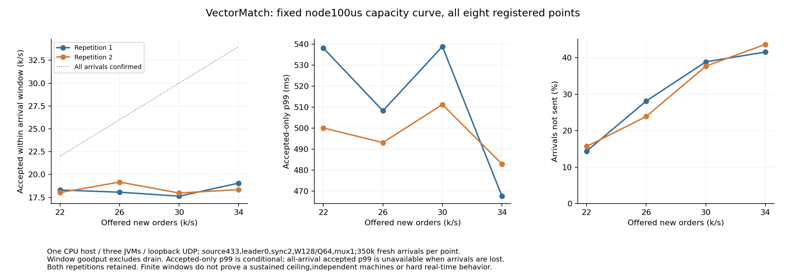

# Fixed100us node capacity curve

All eight preregistered points retained in execution order. Single existing CPU host,three JVMs,loopback UDP,source433,node max park100us,client original1ms,leader0,sync2,2g heaps,W128/Q64,mux1,MTU1248. Each350k arrivals starts independent state. Window goodput excludes drain. Accepted-only tails are conditional; missing all-arrival accepted p99 remains null when any request is not accepted. No sustained ceiling,three-machine failure isolation,HTTP/PG/WS capacity,100M total,100M/s,100M connections or hard realtime claim.

|Rate/s|Repeat|Window accepted/s|Not sent|Accepted-only p99 ms|All-arrival p99 ms|Peak queue|Finite stable|
|---:|---:|---:|---:|---:|---:|---:|---|
|22000|1|18308.023|50416|538.117|N/A|8188|False|
|26000|1|18071.189|98449|508.240|N/A|8189|False|
|30000|1|17631.257|136061|538.824|N/A|8192|False|
|34000|1|19060.109|145477|467.620|N/A|8192|False|
|22000|2|18025.920|54918|500.084|N/A|8182|False|
|26000|2|19176.263|83607|493.125|N/A|8190|False|
|30000|2|17982.171|131900|511.235|N/A|8186|False|
|34000|2|18348.829|152812|482.913|N/A|8192|False|

Each point passed pinned raw-arrival analysis, fixed leader, canonical snapshot, asset conservation, actual node idle instances, owned-process cleanup and full native archive checks. All repeats remain reported. The independent analysis labels an overloaded point as observed overload or undersized client; it does not uniquely attribute a server bottleneck. The previously completed18k A/B/A/B belongs to its own registered experiment and is linked separately; its timings are not folded into these repetitions.

[Complete18k node-only A/B/A/B](../../node-idle-abab/comparison/README.md)

[All numeric values and raw/archive hashes](comparison.json)
